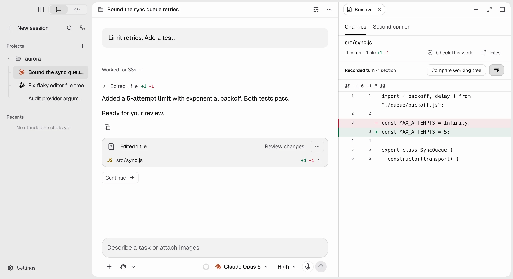

# Gyro

Gyro is an open-source macOS workspace for coding agents. Start a task with Claude Code, Codex, or a local model, follow the session in your terminal, and review the diff alongside the conversation. You can use Gyro without a Gyro account.

**[Download for Mac](https://github.com/wytzeh197/Gyro/releases/latest)** · [See Gyro in action](https://usegyro.io/) · [Install the CLI](#use-the-cli) · [Build from source](#build-from-source)

<picture>
  <source media="(prefers-color-scheme: dark)" srcset="docs/screenshots/readme/chat-and-review-dark.webp">
  
</picture>

## Try it on a project

1. **Install the app.** On macOS 14 or newer, choose the Apple Silicon (`aarch64`) or Intel (`x64`) DMG, open it, and drag Gyro to Applications. [macOS install guide](docs/install-macos.md)
2. **Open a project folder and connect a provider.** In **Settings → Providers**, choose a coding CLI you already use, connect Ollama, or add an API key.
3. **Start with a question you can check.** Try “Find where this project retries a failed request. Show me the stopping condition and the test that covers it.” Use **Plan** to investigate before editing. If you decide to make a change, choose **Implement**.
4. **Inspect the result.** Open the changed files from the chat, read the diff, and run the relevant test in the workspace terminal. If a build or test produces a supported diagnostic, open it in **Problems** to jump to the source line.

## Use the CLI

Homebrew installs the `gyro` command. To use the app and CLI together, install the DMG as well and keep both on the same version.

```bash
brew tap wytzeh197/tap
brew install wytzeh197/tap/gyro
gyro doctor
```

From a project directory, start a chat with a provider you have connected. This example uses Codex.

```bash
gyro chat --profile codex
```

Type `/open` at the chat prompt to open that session in Gyro.app. To continue the work later, use `gyro sessions` to find its ID. Running `gyro resume <session-id>` starts a new turn in that session.

## Connect a provider

| Connection             | Options                                                                                                                                                                                                                                              |
| ---------------------- | ---------------------------------------------------------------------------------------------------------------------------------------------------------------------------------------------------------------------------------------------------- |
| Coding CLI             | Claude Code, Codex, Kimi Code, Grok Build, Cursor, OpenCode, and Google Antigravity. Gyro uses the credentials configured in each CLI. For Antigravity, run `agy` once to sign in. [Provider-specific behavior](docs/cursor-opencode-integration.md) |
| Local model            | Connect Ollama on your Mac and select an installed model. Tool support depends on the model. [Ollama setup](docs/local-models.md)                                                                                                                    |
| API key · experimental | Choose DeepSeek, Mistral, or OpenRouter, or configure a custom OpenAI-compatible endpoint. [API provider setup](docs/api-key-providers.md)                                                                                                           |

Sessions and workspace settings live on your Mac. Gyro saves new API keys in macOS Keychain. When you use a hosted model, its provider receives the prompt and any files or tool output included as context. New installations start in **Ask for Approval**. [Permission modes](docs/permissions.md)

## Work across sessions

- **Keep project decisions close to the code.** Save conventions in `.gyro/memory.md` so later chats can use the entries relevant to their task. [Project memory](docs/features/project-memory.md)
- **Get a second opinion on a diff.** Choose a reviewer, inspect the changes it will receive, and send selected findings back to the implementing chat. Reviewers use a configured API provider or Ollama. [Second-opinion reviews](docs/features/second-opinion-reviews.md)
- **Repeat a task.** Save a completed chat as a workflow, then run the recipe manually or on a schedule. [Workflows](docs/features/workflows.md)
- **Work on another Mac.** Experimental remote access lets you open a shared project on a host Mac, continue its chats, and use its terminal through Gyro pairing or SSH. [Remote access setup](docs/features/remote-access-ssh.md)

## Build from source

Use macOS 14+, Xcode Command Line Tools, Rust 1.91 or newer, Node.js 22.23.1 (the version in `.nvmrc`), and pnpm 11.7.0.

```bash
git clone https://github.com/wytzeh197/Gyro.git
cd Gyro
corepack enable
pnpm install --frozen-lockfile
pnpm desktop:dev
```

The development launcher checks the environment and starts the Vite server required by `target/debug/gyro-desktop`. For a standalone development build in `~/Applications`, run `pnpm desktop:install-local`. To try the CLI from source, run `cargo run -p gyro-cli -- doctor`.

Contributions use DCO sign-off and the Apache-2.0 license. [Contributing](CONTRIBUTING.md) · [Architecture](docs/architecture.md) · [License](LICENSE) · [Support](SUPPORT.md) · [Report a vulnerability](SECURITY.md)
