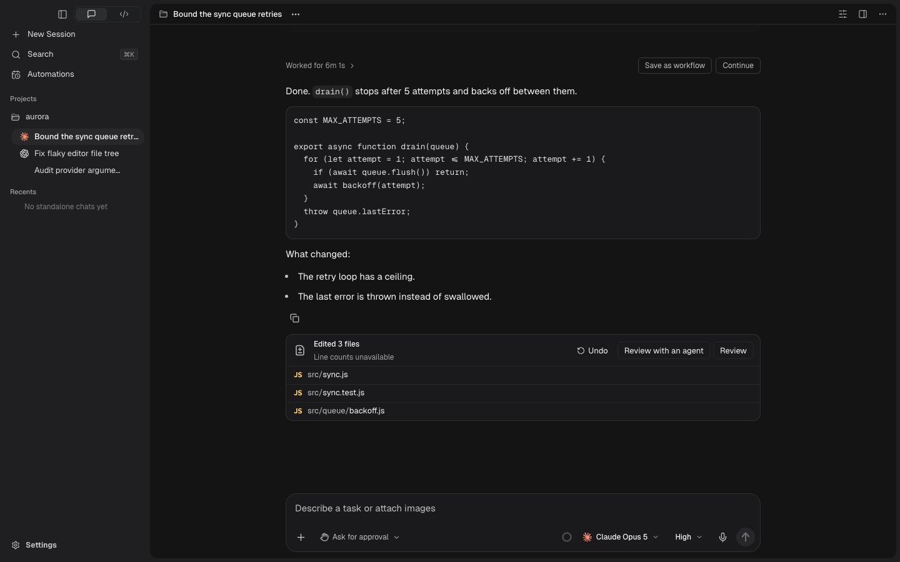

# Chat design pass — list alignment and response rhythm

2026-11-10, after Wytze's annotated screenshot. This supersedes the earlier
visual acceptance for reply lists. The production UI was corrected directly;
no replacement chat mockup was built.

## What was wrong

The user's marked area was a real cascade defect. A more specific rule gave
lists only 3px of inset, overriding the intended 16px. Native outside markers
therefore protruded to the left of the reading column. List text also used a
24.75px line height while the surrounding body advertised 24px. The earlier
checks measured the body box, so they missed the child typography and marker
gutter. Passing those checks did not establish visual quality.

## Review steps

1. **Read the finished reply — corrected.** The same real app, viewport and
   code/list fixture were captured before and after. Bullets now sit inside the
   column, text has a 20px hanging inset, and paragraphs/items share 15px / 1.6
   reading metrics at default size. Code, file cards and composer retain their
   shared column.
2. **Read wrapped and numbered items — verified in the preview.** A dedicated
   fixture uses long items and steps 9–10. Wrapped lines start on the text edge,
   numbers have a 24px marker gutter plus 4px item inset, and item gaps use 8px.
   Native `<ul>`, `<ol start>` and `<li>` semantics remain intact.
3. **Reach the response action — verified.** Copy retains its real control,
   label and hit area. Its top gap is 8px. Shift+Tab from Undo reached Copy and
   displayed the actual 2px chosen-accent focus outline in the light theme.

All spacing scales with the interface preference. The fix removes conflicting
list rules and inactive custom-marker styles in `packages/ui/src/chat.css`;
it does not add a stronger overlay. No agent content, status, provider handler
or action behavior was changed.

## Evidence

[Before, same viewport](../../mockups/chat-thread/screenshots/design-pass-2026-11-10/01-before.jpg)

[Numbered steps, light/large/narrow](../../mockups/chat-thread/screenshots/design-pass-2026-11-10/03-wrapped-numbered-light.jpg)
· [Wrapped bullets, light/large/narrow](../../mockups/chat-thread/screenshots/design-pass-2026-11-10/04-wrapped-items-light.jpg)

The before/after files were opened together for comparison. An attempted detail
capture returned the wrong crop and was discarded; the accepted captures above
are actual app screenshots.

## Verification and limits

- The rendered matrix now has **112 states**, including 12 wrapped/numbered
  list states across themes, viewports and interface sizes. It passed with the
  deliberately updated design baseline.
- New contracts inspect the winning list inset/gap, native marker type, actual
  text-fragment indentation and child paragraph/list-item line heights. They
  catch the original higher-specificity override and the old numbered-item
  padding that source-text presence checks missed.
- Source smoke, token/ownership guards and desktop TypeScript passed. Chat CSS
  remains one owner, with zero `!important`; the rule budget decreased to 2,804.
- Browser review covered the marked finished reply, wrapping, two-digit
  numbering, and Copy focus. Empty/streaming/pane states remain in the renderer
  matrix. Error/recovery interaction flows were not re-audited for this pass.
- This is source and browser-fixture verification. The installed app was not
  replaced, no provider turn was sent, and native/release acceptance for this
  correction is not claimed. Screenshots alone do not establish accessibility
  compliance.

## Candidate project rule

Proposed for Gyro's `AGENTS.md`, not added to shared instructions:

> In a reply, keep list markers inside the shared column and align wrapped
> lines to the list text edge.

Reason: markers in the gutter look detached from their message and compete
with reply controls. This is a scoped proposal from the reported chat mistake,
not a new universal rule for every list in every product.
