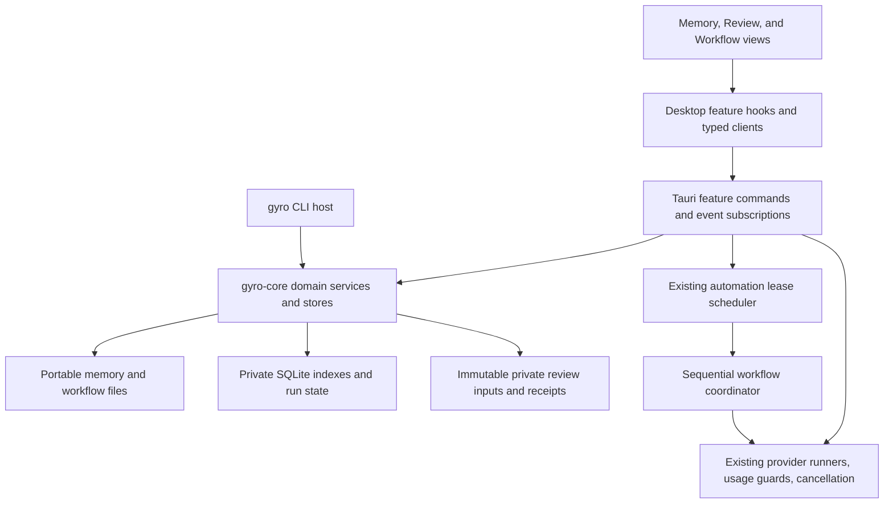
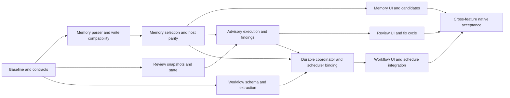

# Gyro v0.1.2 implementation plan

Date: 2026-11-10. Status: proposed implementation specification; no feature implementation is claimed by this document.

Scope selected by Wytze: **project memory, second-opinion reviews, and reusable workflows**. The intended result is a local workflow in which one agent uses established project knowledge, another reviews a specific change, and the user saves a successful procedure for later use.

Source baseline: commit `07dfacdbb93ba8be2c13df9bcca20ade70169ee9`, checkout branch `Heads/v0.1.2`. Findings below describe inspected source, not installed-app acceptance. Existing uncommitted work includes a chat styling consolidation plan and render snapshots; that work is independent of this plan. Recheck the checkout before starting implementation.

The backend and frontend changes, navigation placements, proposed data contracts, sequencing, and acceptance criteria below are intended to be concrete enough to turn into implementation PRs. Proposed types, filenames, commands, and screens are explicitly future work. Existing code is identified by links and symbols.

## Contents

1. [Release scope and decisions](#1-release-scope-and-decisions)
2. [Current code and extension points](#2-current-code-and-extension-points)
3. [Shared architecture and data ownership](#3-shared-architecture-and-data-ownership)
4. [Design placement and shared UI rules](#4-design-placement-and-shared-ui-rules)
5. [Project memory](#5-project-memory)
6. [Second-opinion reviews](#6-second-opinion-reviews)
7. [Reusable workflows](#7-reusable-workflows)
8. [Transport and integration contracts](#8-transport-and-integration-contracts)
9. [Implementation sequence](#9-implementation-sequence)
10. [Verification and release gates](#10-verification-and-release-gates)
11. [Risks and implementation decisions](#11-risks-and-implementation-decisions)
12. [Completion checklist](#12-completion-checklist)

## 1. Release scope and decisions

### 1.1 Required outcomes

| Feature                | Required v0.1.2 outcome                                                                                                                           | Boundary                                                                                                        |
| ---------------------- | ------------------------------------------------------------------------------------------------------------------------------------------------- | --------------------------------------------------------------------------------------------------------------- |
| Project memory         | Relevant, inspectable knowledge survives new chats and provider changes, with provenance, correction, and forgetting.                             | Local project memory. Retrieval must not require embeddings, a hosted service, or a paid background model call. |
| Second-opinion reviews | A user chooses a reviewer, reviews a precise snapshot against the request, sends selected findings for fixes, and reviews the resulting revision. | One reviewer per review attempt. Review itself cannot edit the project, run commands, delegate, or publish.     |
| Reusable workflows     | A user saves an editable procedure from a successful chat or creates one manually, supplies new inputs, runs it, and optionally schedules it.     | A bounded sequential procedure using existing provider execution and scheduling infrastructure.                 |

All three belong in the usable local product without a Gyro account. Existing provider subscriptions, API keys, and local-model requirements continue to apply. Source files and saved context sent to a chosen external model leave the machine through that provider as ordinary model input; “local storage” must not be presented as “no provider receives this data.”

### 1.2 Proposed implementation decisions

These decisions make the plan implementable. They are proposals for this release, not claims that the corresponding UI or API exists.

1. Keep `.gyro/memory.md` as the portable project-memory authority. Add structured metadata incrementally, with a rebuildable private index.
2. Treat each authorized workspace root as its own memory scope. A worktree reads its own checkout's memory. Do not silently pull another worktree's uncommitted memory into a run.
3. Capture immutable review inputs in private Gyro storage. Store review state and findings separately from edit-approval decisions.
4. Use dedicated durable review sessions with a backend-enforced advisory execution policy. Do not repurpose transient Side chat, which is destroyed on close.
5. Store portable workflow definitions as versioned JSON under `.gyro/workflows/`. Keep draft extraction, runs, input values, schedules, and provider bindings private by default.
6. Reuse automation leases, admission, cancellation, scheduling, and provider dispatch. Extend them with a durable step coordinator instead of creating a second scheduler.
7. Keep the global **Automations** destination. Add local **Workflows**, **Schedules**, and **Runs** views there. Existing schedules remain reachable and retain their behavior.
8. Add **Memory** to the chat companion's tool picker. Add second-opinion controls to the existing **Review** tool. A running workflow opens as a normal durable task session with a run detail view.
9. Make automatic memory suggestions use the active turn's model output where supported. No extra call merely because a turn finished. Extracting a workflow is an explicit, metered action.
10. Keep all run roles and authority backend-owned. Renderer fields, repository files, model text, and a saved workflow cannot upgrade permissions.

### 1.3 Scope kept for later

This release does not require autonomous agent teams, arbitrary workflow graphs, branching/repeating workflow programs, a marketplace, Cloud sync, hosted execution, phone control, automatic provider fallback, automatic merge/push, or a new Gyro Check engine. Existing checks may be used as workflow verification actions through their existing execution and approval contracts.

The workflow executor supports an ordered list of agent, review, and verification steps. A finding-to-fix loop is an explicit continuation/review action, not an unbounded automatic loop. A failed workflow does not extract or promote itself as a successful recipe.

## 2. Current code and extension points

### 2.1 Backend source map

| Existing owner                                                                                                                                                                    | Verified source behavior                                                                                                                                                                      | Planned use                                                                                                                    |
| --------------------------------------------------------------------------------------------------------------------------------------------------------------------------------- | --------------------------------------------------------------------------------------------------------------------------------------------------------------------------------------------- | ------------------------------------------------------------------------------------------------------------------------------ |
| [memory_capability.rs](../../apps/desktop/src-tauri/src/memory_capability.rs), `execute`, `schema`, `memory_read_result`                                                          | `.gyro/memory.md`; append/forget; bounded reads; 200 entries, 500 characters per new entry, 256 KiB file ceiling. Writes use the mutation proposal lane. Plan-mode memory writes are refused. | Thin capability adapter over a new shared memory domain; preserve old calls and limits initially.                              |
| [workspace_edit_capability.rs](../../apps/desktop/src-tauri/src/workspace_edit_capability.rs), `execute`                                                                          | Exact edits and whole-file proposals share hash checks, proposal storage, and application. Checks unsaved buffers and delegated authority.                                                    | Memory and workflow-definition edits use the same authority and conflict rules.                                                |
| [workspace_mutations.rs](../../apps/desktop/src-tauri/src/workspace_mutations.rs)                                                                                                 | Desktop mutation orchestration used by the memory and workspace-edit capabilities.                                                                                                            | Apply reviewed memory/workflow document changes without a separate write bypass.                                               |
| [providers/prompt.rs](../../apps/desktop/src-tauri/src/providers/prompt.rs), `provider_context_message_with_capabilities_for_turn`                                                | Stable instruction prefix and per-turn context tail; history, goals, plans, attachments, workspace briefing. Internal calls use an isolated prompt.                                           | Inject bounded memory context in the per-turn tail and add feature-specific internal purposes.                                 |
| [provider_runtime/types.rs](../../crates/gyro-core/src/provider_runtime/types.rs), `ProviderChatRequest`, `InternalRequestPurpose`                                                | Shared desktop/CLI request contract; internal purpose is not deserialized from renderer input.                                                                                                | Shared memory selection DTO; new review/extraction purposes and trusted execution metadata.                                    |
| [providers/run.rs](../../apps/desktop/src-tauri/src/providers/run.rs), `run_provider_chat_blocking`                                                                               | Desktop run preparation, current workspace check, provider execution, completion handling.                                                                                                    | Resolve feature context before dispatch and schedule candidate extraction from completed output.                               |
| [runner_host/mod.rs](../../crates/gyro-cli/src/runner_host/mod.rs), `context_message`                                                                                             | CLI host currently builds its own history-plus-message context.                                                                                                                               | Add the same core memory-selection renderer; desktop prompt changes alone cannot provide CLI parity.                           |
| [runner_host/local_tools.rs](../../crates/gyro-cli/src/runner_host/local_tools.rs), `CliToolCatalog`                                                                              | Headless catalog exposes a small implemented subset of workspace operations, not the desktop memory tool catalog.                                                                             | Add only implemented memory read/search/write adapters, using confined reads and terminal approvals.                           |
| [capabilities.rs](../../crates/gyro-core/src/capabilities.rs)                                                                                                                     | Canonical IDs, descriptors, mode filtering, policies, and provider manifest.                                                                                                                  | Extend memory schemas and restrict review roles consistently with advertised capabilities.                                     |
| [capabilities/execute.rs](../../apps/desktop/src-tauri/src/capabilities/execute.rs) and [capabilities/mcp_server.rs](../../apps/desktop/src-tauri/src/capabilities/mcp_server.rs) | Desktop dispatch and MCP exposure.                                                                                                                                                            | Update the actual broker and catalog together; do not merely add prompt instructions.                                          |
| [delegated_agents.rs](../../apps/desktop/src-tauri/src/delegated_agents.rs), `spawn_with_runtime`, `inherit_parent_permissions`, `restrict_context`                               | Governed child sessions inherit parent provider/model, workspace roots, and permission ceiling. Normal-mode children can be working agents. Children cannot recursively delegate.             | Reuse lifecycle patterns, status presentation, and cancellation infrastructure; add a separate review-purpose creation API.    |
| [subagent_capability.rs](../../apps/desktop/src-tauri/src/subagent_capability.rs), `ChildRunControl`                                                                              | Child provider-slot admission, cancellation ownership, and lifecycle.                                                                                                                         | Extract or reuse admission primitives where suitable; do not require an active parent turn to launch a human-requested review. |
| [git/review.rs](../../apps/desktop/src-tauri/src/git/review.rs), `git_review_content`                                                                                             | Original/modified text and unified diffs; handles exclusions and size limits; resolves branch base once per request.                                                                          | Build complete multi-file immutable snapshots. Current per-file diff responses are not a durable review snapshot.              |
| [file_review.rs](../../crates/gyro-core/src/file_review.rs)                                                                                                                       | Per-file descriptions, content hashes, cached summaries, and keep/ask decisions.                                                                                                              | Reuse hashing ideas; retain this existing feature separately from model code-review findings.                                  |
| [providers/change_summary.rs](../../apps/desktop/src-tauri/src/providers/change_summary.rs), `run_change_summary_call`                                                            | Metered internal text call using Council-mode tool denial; currently reserves the parent session.                                                                                             | Reference for isolated advisory calls. New reviews need their own session so they do not occupy the implementing chat.         |
| [automations.rs](../../crates/gyro-core/src/automations.rs)                                                                                                                       | Manual/calendar schedules, execution metadata, run history, triage, and durable leases.                                                                                                       | Link a schedule to a pinned workflow version and coordinate step runs.                                                         |
| [automation/scheduler.rs](../../apps/desktop/src-tauri/src/automation/scheduler.rs), `execute_claimed_automation`                                                                 | Creates a normal durable session, dispatches one provider request, links it to the lease, and requires command/file approval.                                                                 | Branch execution into legacy single-prompt or versioned-workflow mode after claiming the same lease.                           |
| [automation/runtime.rs](../../apps/desktop/src-tauri/src/automation/runtime.rs), `AutomationRunAdmission`, `AutomationLeaseHeartbeat`                                             | Global provider-slot admission and heartbeat; busy interactive work leaves a schedule due.                                                                                                    | Preserve this behavior for each workflow step; never hold several provider slots for one sequential run.                       |
| [automation/execution.rs](../../apps/desktop/src-tauri/src/automation/execution.rs)                                                                                               | Workspace/worktree resolution and model-reported stop-condition marker parsing.                                                                                                               | Reuse binding resolution; keep stop-condition claims distinct from independently executed verification results.                |
| [usage.rs](../../crates/gyro-core/src/usage.rs) and [usage_receipts.rs](../../crates/gyro-core/src/usage_receipts.rs)                                                             | One ledger entry per provider call; measured/estimated accounting; global and unattended guard behavior.                                                                                      | Attribute reviews, extraction, and workflow steps without losing unattended-budget enforcement.                                |
| [sessions.rs](../../crates/gyro-core/src/sessions.rs), [sqlite.rs](../../crates/gyro-core/src/sqlite.rs), [paths.rs](../../crates/gyro-core/src/paths.rs)                         | Session schema/migration, pooled SQLite, private paths, durable JSONL history.                                                                                                                | Add domain tables, immutable artifact directories, and small versioned session-event payloads.                                 |

The earlier shorthand “delegation is read-only” is incomplete for this checkout. `delegated_agents.rs` contains working child agents in Normal mode, while the README's delegated-research description is narrower. Neither source establishes native acceptance of every provider. The new review role must be tested independently.

### 2.2 Frontend and design source map

| Existing owner                                                                                                                                                                                                                                                               | Current role                                                                                                                                            | Planned extension                                                                                                              |
| ---------------------------------------------------------------------------------------------------------------------------------------------------------------------------------------------------------------------------------------------------------------------------- | ------------------------------------------------------------------------------------------------------------------------------------------------------- | ------------------------------------------------------------------------------------------------------------------------------ |
| [App.tsx](../../apps/desktop/src/App.tsx)                                                                                                                                                                                                                                    | Desktop transport, selected session/root, companion state, automation and review wiring; multiple render paths including tiled chats.                   | Thin wiring to feature hooks. No feature stores or large new rendering branches inline.                                        |
| [surfaces.tsx](../../packages/ui/src/surfaces.tsx), `ChatSurface`, `ChatSidePanel`, `ChatEnvironmentPopover`, `AutomationsSurface`, `AutomationDetail`                                                                                                                       | Existing shells, tool routes, Environment, review entry points, schedules, and detail layout.                                                           | Mount extracted feature components and supply typed callbacks. Preserve existing review/approval routes.                       |
| [types.ts](../../packages/ui/src/types.ts)                                                                                                                                                                                                                                   | `ChatSidePanelId`, automation DTOs, artifacts, workbench state.                                                                                         | Add Memory routing and imports/re-exports of focused domain DTOs.                                                              |
| [chat-companion.ts](../../packages/ui/src/chat-companion.ts)                                                                                                                                                                                                                 | Per-pane dock tabs, widths, layout restoration, narrow-pane overlay. Existing tabs include Review, Files, Agents, Side chat, Browser, Terminal, Canvas. | Add one Memory tab and persistence compatibility. Reuse Review for second opinions.                                            |
| [chat-companion-host.tsx](../../packages/ui/src/chat-companion-host.tsx)                                                                                                                                                                                                     | Stable pane-local portals, focus ownership, overlay/inert behavior.                                                                                     | Memory/review views use the same host; async updates cannot steal another pane's focus.                                        |
| [review-scope.ts](../../packages/ui/src/review-scope.ts)                                                                                                                                                                                                                     | Distinguishes proposed edits, working tree, branch, and historical turn. A turn does not borrow the current working tree.                               | Preserve these semantics in review setup and snapshot construction.                                                            |
| [git-comparison-review.tsx](../../packages/ui/src/git-comparison-review.tsx), `GitComparisonReview`                                                                                                                                                                          | Existing diff inspection, compact/wide layout, file toggle, and historical patches.                                                                     | Add a review-session wrapper and finding anchors; frozen review views load snapshot content.                                   |
| [review-file-navigator.tsx](../../packages/ui/src/review-file-navigator.tsx), [plain-diff-view.tsx](../../packages/ui/src/plain-diff-view.tsx)                                                                                                                               | File tree and unified diff presentation.                                                                                                                | Finding counts and snapshot-bound location navigation.                                                                         |
| [file-review.ts](../../packages/ui/src/file-review.ts) and [chat-artifacts.tsx](../../packages/ui/src/chat-artifacts.tsx)                                                                                                                                                    | End-of-turn reading pass and existing memory artifact. The memory artifact currently sends a prompt when clicked.                                       | Keep file summaries; replace new structured memory candidate actions with direct typed commands, not another model round trip. |
| [subagents.ts](../../packages/ui/src/subagents.ts), [subagents-view.tsx](../../packages/ui/src/subagents-view.tsx)                                                                                                                                                           | Agent activity, status, usage, and report presentation.                                                                                                 | Show an explicit Reviewer role and link to durable review detail, without treating a report as edit approval.                  |
| [automation-choice.tsx](../../packages/ui/src/automation-choice.tsx)                                                                                                                                                                                                         | Searchable provider/model style selector with keyboard navigation.                                                                                      | Reuse or extract a neutral picker without copying its implementation.                                                          |
| [workbench-state.ts](../../packages/ui/src/workbench-state.ts), [scheduled-work.ts](../../packages/ui/src/scheduled-work.ts)                                                                                                                                                 | Existing UI reducer and schedule presentation.                                                                                                          | Keep selected IDs/layout only; feature records stay in feature hooks backed by native state.                                   |
| [styles-foundation.css](../../packages/ui/src/styles-foundation.css), [companion-design.css](../../packages/ui/src/companion-design.css), [review-design.css](../../packages/ui/src/review-design.css), [automation-detail.css](../../packages/ui/src/automation-detail.css) | Actual tokens and established companion/review/automation styling.                                                                                      | Reuse materials, typography, spacing, controls, and layout behavior.                                                           |

The [chat consolidation draft](../design/chat-consolidation-plan-2026-11-10.md) proposes future chat styling changes. It is not the current token contract and must not be treated as already approved or applied. The new feature CSS must avoid adding another global chat overlay.

## 3. Shared architecture and data ownership

### 3.1 Dependency shape



`gyro-core` owns parsing, validation, selection, state transitions, persistence, and portable contracts. It must not import Tauri. The desktop owns native commands, event emission, provider-host integration, and UI-to-domain authority binding. `packages/ui` owns presentation and pure reducers; it must not import Tauri or provider SDKs.

### 3.2 Proposed module layout

```text
crates/gyro-core/src/
  project_memory/{mod,document,types,selection,index,tests}.rs
  code_reviews/{mod,types,snapshot,store,findings,tests}.rs
  workflows/{mod,definition,types,store,transitions,tests}.rs

apps/desktop/src-tauri/src/
  project_memory/{mod,commands,context,candidates}.rs
  code_reviews/{mod,commands,capture,execution}.rs
  workflows/{mod,commands,extraction,coordinator}.rs
  automation/                     # existing scheduler remains the owner

apps/desktop/src/
  project-memory-client.ts
  use-project-memory.ts
  code-review-client.ts
  use-code-reviews.ts
  workflow-client.ts
  use-workflows.ts
  v012-feature-fixtures.tsx

packages/ui/src/
  project-memory/{types,state,panel,entry,candidate,context-receipt}.ts[x]
  code-review/{types,state,setup,summary,findings,finding}.ts[x]
  workflows/{types,state,library,editor,run-setup,run-detail}.ts[x]
  project-memory.css
  code-review.css
  workflows.css
```

Names above are proposed. Keep modules focused; use explicit Rust imports. The existing [architecture boundary guard](../../scripts/check-architecture-boundaries.mjs) and [size baseline](../../scripts/architecture-size-baseline.json) must continue to apply. Extract existing automation/review shells as needed to stay below the ceilings; raising a ceiling is not the implementation strategy.

### 3.3 Storage authorities

| Data                               | Authority                                                 | Derived/private data                                                  | Conflict rule                                                                                |
| ---------------------------------- | --------------------------------------------------------- | --------------------------------------------------------------------- | -------------------------------------------------------------------------------------------- |
| Accepted project memory            | Workspace `.gyro/memory.md` bytes                         | Rebuildable SQLite search index, local provenance, selection receipts | Compare document hash; never overwrite a concurrent external edit.                           |
| Pending memory suggestion          | Versioned session event with candidate ID and source turn | Candidate-list projection                                             | Idempotent decision; candidate acceptance validates current document and current permission. |
| Review input                       | Immutable private snapshot manifest and blobs             | Hash/index columns in SQLite                                          | Content-addressed; capture twice/validate before dispatch; never mutate in place.            |
| Review execution/finding lifecycle | Private review tables and transition journal              | Small linked session events for chat presentation                     | Revision-guarded transitions; duplicate delivery cannot duplicate findings or fixes.         |
| Workflow definition                | `.gyro/workflows/<id>.json`                               | Private index keyed by canonical root and file hash                   | Expected hash on every save; unsupported schema is readable as an error, never executable.   |
| Workflow run                       | Private workflow tables with durable step journal         | Parent task session and child step-session links                      | Compare-and-swap transitions, unique step-attempt keys, idempotent linkage.                  |
| Schedule                           | Existing automation store with pinned workflow binding    | UI schedule projection                                                | Reuse lease owner and expiry; edits cannot replace a running definition.                     |

Use SQLite transactions within each feature's state transitions. For JSONL events or filesystem artifacts outside a transaction, use an outbox/reconciliation record with a stable operation ID: persist intent, perform the external append/write, then acknowledge. Recovery reconciles unfinished operations. Do not claim a filesystem write and a database transaction are atomic together.

Large snapshots and transcripts do not travel in UI events or duplicate into JSONL. Events contain IDs, revision, status, counts, and a bounded summary. Native fetch commands load paginated details. Feature state must be reconstructible after missed events; events are invalidation hints, not the only copy of the result.

### 3.4 Common identity and permissions

- Bind every command to a known session and an authorized `rootId`; resolve the canonical path in the backend. A renderer-supplied absolute path is not authority.
- Record a distinct run ID, step/attempt ID, parent session, source turn, provider/model identity, and workspace identity where applicable.
- Recheck authority when a queued action starts and when an approved mutation is applied. Permissions may tighten while a task waits.
- Keep context observation separate from mutation permission. Retrieved memory, a reviewer recommendation, and a workflow definition cannot grant an action.
- Refuse symlink/path traversal and unsafe private artifact paths. Reuse secure private-directory/file helpers and descriptor-bound reads where available.
- Store run records privately using current path conventions. No project contents, prompts, or findings in telemetry.
- Additive SQLite migrations must run through the owning store's initialization; coordinate changes to `SESSION_STORE_SCHEMA_VERSION`, `ensure_current_schema`, and `StoreSchema` caching rather than creating competing `user_version` schemes in the same database.

## 4. Design placement and shared UI rules

### 4.1 Information architecture

```text
Sessions
  Project / chat
    Tools → Memory                   new companion tab
    Tools → Review                   existing companion tab
      Changes | Second opinion       local review modes
    Chat options → Save as workflow  new explicit extraction action
    Composer commands
      /memory                        opens Memory
      /review                        opens second-opinion setup
      /workflow                      opens workflow picker

Workspace
  Source control / existing diff review
    Review with an agent             same snapshot/setup path as chat

Automations                          existing global destination
  Workflows | Schedules | Runs        new local organization
    Workflow → Edit / Run / Schedule
    Run → Steps / Result / History

Settings → Context efficiency        existing section
  Project memory behavior            retrieval and suggestion preferences
```

These new tabs, commands, and actions are proposed additions. They are not existing components. Preserve existing schedule deep links, automation creation commands, and selection IDs when adding the local organization. Direct review entry points preselect their actual scope; they must not reinterpret a historical turn as the current branch.

Add project-level Memory and Workflows entry points to the existing project overflow menu only after confirming its current owner during implementation. They are shortcuts to the same views, not separate state owners. Projectless chats have session-scoped context only; do not label their private temporary workspace as durable project knowledge.

### 4.2 Actual visual system to reuse

| Job                     | Existing tokens/patterns                                                                                                                                                   |
| ----------------------- | -------------------------------------------------------------------------------------------------------------------------------------------------------------------------- |
| Canvas and tool surface | `--gyro-app`, `--gyro-pane`, `--gyro-surface`; companion content inherits its surround.                                                                                    |
| Raised/editor controls  | `--gyro-surface-raised`, `--gyro-surface-soft`, `--gyro-control-bg`, `--gyro-control-hover`.                                                                               |
| Text and metadata       | `--gyro-text`, `--gyro-muted`, `--gyro-faint`; Geist via `--gyro-font-sans`, code via `--gyro-font-mono`.                                                                  |
| Type                    | Existing body/support/micro/chrome/heading tokens. Do not add a feature-specific tiny type scale.                                                                          |
| Dividers and focus      | `--gyro-border`, `--gyro-border-soft`, `--gyro-border-strong`, `--gyro-focus-ring`, `--gyro-accent-soft`.                                                                  |
| Spacing                 | `--gyro-space-compact`, `--gyro-space-standard`, `--gyro-space-comfortable`, `--gyro-space-card`, `--gyro-space-panel`, `--gyro-space-section`.                            |
| Corners                 | Existing `--gyro-radius-*`; utility controls use the current companion rhythm, not composer-sized corners.                                                                 |
| Motion                  | `--gyro-premium-motion-fast`, `--gyro-premium-motion`, `--gyro-premium-motion-slow`, `--gyro-premium-ease`; respect reduced motion.                                        |
| Action hierarchy        | Existing `gyro-primary-button`, `gyro-secondary-button`, `gyro-icon-button` styling patterns. They are CSS patterns, not a claimed shadcn component library.               |
| Meaning                 | `--gyro-attention` for waiting on the user, `--gyro-warn` for caution, `--gyro-danger` for errors/destructive actions. Keep brand/provider marks and existing diff colors. |

Use the currently resolved tokens, including theme/density overrides. The foundation file is not the only cascade owner. Do not introduce the design kit's zinc/Inter/shadcn starter values. No new palette or generic dashboard cards are needed.

Finding severity should use text and an icon first. Do not paint all review findings red, or use a green “approved” badge for a model's empty finding list. Use “No findings reported” with explicit coverage. Finished execution is different from verified correctness.

### 4.3 Shared interaction requirements

1. Each editor/setup view has one primary action: Save memory, Start review, Save workflow, or Run workflow. Secondary actions remain visually secondary.
2. Put summary and current state before logs. Expose exact input, provenance, and receipts through disclosure or detail views.
3. Use the existing companion host's width, resize, expansion, and narrow-pane overlay logic. Do not create another floating panel or cover the composer with persistent feature chrome.
4. Only the focused pane can move keyboard focus. Returning from Memory/Review restores the opener. Background completion updates status without opening a panel.
5. Every feature distinguishes loading, empty, ready, saving/running, error, and stale/conflict states. Keep previous content readable while refreshing.
6. Announce completion and errors through a polite status region; do not announce each streamed token or list rerender.
7. Lists use stable IDs, accessible names, explicit selected state, and keyboard activation. Context menus have visible alternatives.
8. Escape closes the current picker/dialog first. It must not silently stop a run or discard an edited definition. Unsaved edits use the existing discard pattern.
9. Long paths, finding titles, and workflow names wrap or truncate with accessible full text. Footer actions remain reachable at compact density and larger UI scale.
10. Controls may be disabled only with an actionable explanation: no workspace, missing reviewer login, busy source session, unsupported schema, stale snapshot, or unavailable provider.

### 4.4 Wireframes and screen ownership

Proposed Memory companion, using the existing dock chrome:

```text
Chat transcript                    │ Memory                     [dock close]
                                   │ Project / selected root
                                   │ [Search memory              ] [Add]
                                   │ Entries | Suggestions | Used this turn
                                   │
                                   │ Prefer the shared runtime
                                   │ Decision · source · last checked
                                   │ [details / edit / forget]
                                   │
                                   │ 2 suggestions need a decision
                                   │ [Review suggestions]
Composer                           │
```

Proposed second-opinion mode inside Review:

```text
Review dock
  Changes | Second opinion
  Scope: This turn / Uncommitted / Branch
  Reviewer: provider → model                  [Start review]
  -------------------------------------------------------
  Completed · 2 findings · 5 of 6 files reviewed
  Snapshot captured at … · [View input] · [Review again]
  [finding list / selected finding]
  [snapshot diff with selected line range]
  -------------------------------------------------------
  1 selected                                 [Send for fixes]
```

Only one state-specific primary action is shown: Start review before execution, Send for fixes when findings are selected, or Review again after a fix/stale result. Review again remains secondary while a fix selection is the primary task. Existing diff inspection remains usable without a provider.

Proposed Automations destination:

```text
Automations
  Workflows | Schedules | Runs
  Project filter / search                       [New workflow]
  -----------------------------------------------------------
  Workflow list                 │ Selected workflow
  Investigate failed CI         │ Purpose and inputs
  Prepare release notes         │ 1 Investigate  2 Review  3 Verify
                                │ Last result / provider bindings
                                │ [Edit] [Schedule] [Run]
```

At narrow width, list and detail become separate views with Back; preserve draft/input state. Do not keep a three-column workflow editor inside a narrow companion. The workflow picker can open from chat, but full definition editing belongs in Automations.

## 5. Project memory

### 5.1 User journeys

**Recall:** open a project, start a fresh chat, ask for work, and receive a bounded set of relevant established decisions. A “Project memory: 3 entries” receipt opens the exact entries supplied to that turn. Switching provider uses the same selection service.

**Capture:** after a meaningful decision or successful command, the agent proposes a small candidate. The user can accept, edit, or dismiss it without another model call. An explicit “remember this” tool action still follows the current memory-write permission mode.

**Correct:** edit a remembered convention or replace it with a newer decision. The new entry identifies the superseded one. Retrieval immediately stops using the superseded text; earlier turn receipts retain their historical identity without silently changing what the model saw.

**Forget:** remove an entry from future retrieval and its memory index. Explain that already-sent provider context, historical conversations, and explicitly captured review/workflow inputs are not erased by forgetting local project memory. Those artifacts have separate deletion controls. Do not retain the forgotten text in a new hidden memory audit log.

### 5.2 Domain model and document format

Proposed shared types:

```rust
MemoryEntry {
    id: MemoryEntryId,
    root_id: WorkspaceRootId,
    kind: Decision | Convention | Command | OpenProblem | Note,
    text: String,
    status: Active | Superseded,
    created_at: Option<DateTime<Utc>>,
    updated_at: Option<DateTime<Utc>>,
    scope_paths: Vec<WorkspaceRelativePath>,
    supersedes: Option<MemoryEntryId>,
    sources: Vec<MemorySource>,
    entry_hash: ContentHash,
    source_span: DocumentSpan,
}

MemorySource = ProjectFile { path, content_hash, lines }
             | Commit { oid, path }
             | LocalTurn { session_id, turn_id, event_id }
             | UserEntered;

MemoryCandidate {
    id, session_id, turn_id, root_id,
    proposed_entry, proposed_supersedes,
    evidence_refs, decision, revision,
}

MemorySelection {
    root_id, document_hash, entries,
    supplied_bytes, estimated_tokens, omitted_count,
    selection_version, reasons,
}
```

The code-shaped definitions are design contracts, not compilable declarations. Use existing project identity/hash types where available; introduce aliases only where they improve validation.

Preserve the human-editable Markdown document. Proposed managed-entry shape:

```markdown
# Project memory

- 2026-11-10 — Use the shared provider runtime for desktop and CLI execution.
  <!-- gyro-memory:{"v":2,"id":"mem_example","kind":"decision","paths":["crates/gyro-core/src/provider_runtime"],"sources":[{"kind":"commit","oid":"full-verified-commit-id"}]} -->
```

This syntax needs parser/round-trip fixtures before adoption. It is proposed because it keeps the existing bullet representation, plain reading, and editability. Metadata must be strictly bounded and parsed as data, with no arbitrary frontmatter evaluation. Local-turn source details belong in the private provenance projection by default; portable metadata contains only user-visible project-file/commit references. Never write private absolute paths or another chat's text into the repository metadata.

Compatibility rules:

1. Read all existing dated/undated bullets supported by the current parser. Preserve headings, prose, whitespace outside the changed span, and unknown comments byte-for-byte.
2. A legacy entry without an ID gets a provisional identity derived from document hash, byte span, and occurrence. Stabilize it only when that entry is explicitly edited or accepted as managed content. Identical duplicate bullets must remain distinguishable.
3. Do not rewrite the entire memory file during app upgrade, retrieval, or index rebuilding. Show legacy provenance as unavailable; do not invent a source chat or a precise creation timestamp.
4. Keep current size/entry/text limits during the initial parser extraction. New metadata has its own bound; it does not make a 256 KiB memory file unbounded.
5. Validate duplicate IDs, malformed metadata, invalid sources, and supersession cycles. A malformed managed entry is excluded with an explanatory document diagnostic, not silently repaired or executed as instructions.
6. Do not identify contradictions with a simple string similarity threshold. Offer a possible duplicate/replacement; a user decision or explicit structured replacement selects the supersession.
7. Unsupported metadata versions remain visible as source text and unavailable for managed editing. Preserve the file until the user resolves the version conflict.

### 5.3 Backend implementation

**M1. Extract the parser and writer.** Move the document logic out of `memory_capability.rs` into `gyro-core::project_memory`. Keep the existing tool API working through an adapter. Add a lossless span-based document representation, stable IDs for managed entries, structured source validation, and a pure function that produces proposed replacement bytes from an expected document hash.

**M2. Build the local index.** Add a private `project_memory_entries` projection keyed by canonical workspace/root identity, document hash, and entry ID. Store searchable text, kind, relative-path scope, entry hash, and supersession state. The index is rebuildable from the document. Store local-turn provenance separately and invalidate it when the entry text/ID changes externally.

Use deterministic lexical scoring first; the current 200-entry ceiling does not justify a vector database. An in-memory scan over the parsed document can be the initial implementation, with SQLite for lists/provenance/receipts. Do not add FTS or a new dependency unless measurement shows a need. Index deletion and rebuild must not alter accepted memory.

**M3. Resolve root-scoped context.** Given session ID and root ID, use the session's current authorized workspace identity. For multi-root sessions, select independently per root and label supplied entries with that root. Never search all projects by default. For worktrees, read the active checkout's file. Non-Git folders work normally. Missing files mean empty memory, not a read error.

**M4. Select relevant entries.** Implement a pure, versioned selection function with these inputs:

- Current user request and explicitly attached relative paths.
- Current goal/plan titles when already available, without scanning the entire historical transcript.
- Authorized root identity and parsed active entries.
- Provider context-window information when known and an explicit memory budget.

Scoring order: explicitly requested entry/path, matching scoped paths, request-term relevance, active unresolved issue relevance, then deterministic recency/ID tie-breaks. Recency does not make a fact correct. Exclude superseded entries, malformed entries, revoked sources where the entry depends on them, and duplicates within the same payload. An empty or unrelated request can select no entries.

Initial engineering bounds, subject to measurement: at most 8 entries and 6 KiB UTF-8 of rendered memory, including labels/provenance. Keep the existing 500-character content ceiling initially. Treat token counts as estimates unless a tokenizer actually measures them. If the model context window is unknown, use the conservative byte cap. Do not silently truncate an entry into a different meaning; omit it and record why.

**M5. Inject and record.** Add the selection to the per-turn context tail in desktop `providers/prompt.rs`, not the byte-identical instruction prefix. Share the renderer with CLI `CliRunnerHost::context_message`. The injected section explicitly describes remembered project context as potentially dated reference material, subordinate to the current request and permission rules.

Record a `project-memory-context` system event with root, source document hash, entry IDs/hashes, selection version, and supplied size. Do not duplicate full memory text into every event. The UI shows “Supplied to this turn,” which is the strongest host evidence available; it must not claim that the model read or obeyed an entry.

For resumed provider sessions, send bounded deltas and explicit superseded/forgotten IDs when the memory revision changes. A receipt is attached to each actual supplied revision. Test whether each adapter appends fresh turn context on resume. Do not assume changing a host-side string changes an already cached provider session. An unchanged selection need not be resent in full if the adapter's continuation contract preserves it.

**M6. Capture suggestions without hidden calls.** Extend the existing hidden-output parsing pattern with a bounded, versioned memory-candidate payload. Only accept candidates from a completed active turn, bound to that turn/root. Limit to 3 candidates per completion; incomplete/cancelled responses do not auto-promote candidates. Deduplicate using source turn + normalized candidate hash. A candidate must include a useful durable fact and a real evidence reference; model-provided paths/source IDs are validated before linking.

Do not mine every old conversation on startup. Do not trigger a provider call for every success. Manual “Suggest memory from this chat” can be an explicit later action, with an identifiable metered call if added. Candidate generation is disabled for internal review/extraction calls, read-only research children, and workflows unless explicitly enabled in that workflow's reviewed configuration.

**M7. Apply changes through the mutation lane.** Add/accept/edit/supersede/forget operations produce a proposed document delta with an expected hash. Reuse unsaved-editor checks, atomic application, root binding, current policy, and delegated ceilings. Model-triggered writes keep the existing permission behavior. A direct human Save action is the requested edit, but still validates root, file hash, and conflicts; it must not impersonate a running model turn to obtain authority.

Plan mode may display candidates and retrieve memory; it cannot use a model tool to mutate project memory. Direct user editing of the Memory view uses the same explicit human-edit route as other workspace editing. Explain conflicts inline and offer Reload/Review changes; never replay an accepted append against a different document without revalidation.

**M8. Complete CLI parity.** Add implemented memory read/search/write support to `CliToolCatalog` only after the core adapter exists. Use confined workspace reads and the existing terminal proposal/approval path. Supply root-scoped memory on fresh/resumed CLI chats even when a provider cannot call tools. Add fixtures for app-created memory consumed in CLI and CLI-edited memory refreshed in app. Full standalone CLI review/workflow commands are a separate scope decision; memory continuity is required here.

### 5.4 Provenance and freshness

Keep three separate notions:

| Field               | Meaning                                     | UI behavior                                                                                     |
| ------------------- | ------------------------------------------- | ----------------------------------------------------------------------------------------------- |
| Entry state         | Active or superseded by a known entry       | Superseded entries stay inspectable but are excluded from retrieval.                            |
| Source availability | Original turn/file/commit still resolves    | Missing source shows “Source unavailable”; never silently substitute another file/chat.         |
| Source freshness    | A referenced file hash differs from capture | Show “Source changed”; lower retrieval priority or omit dependent assertions until reconfirmed. |

A commit reference remains a historical source even if the branch moves. Age alone is not automatic expiry. Commands record where they worked and may need revalidation after manifest/toolchain changes; never execute a remembered command merely because it was previously successful.

When forgetting, remove the active text and private search copies. Keep only non-content identifiers/tombstones needed for deduplication. Historical chat/provider input may still contain it; any broader deletion must be a separate user-directed action. Memory selection receipts show an unavailable/forgotten entry when its source is gone instead of reconstructing the text from hidden caches.

### 5.5 Frontend component plan

New `use-project-memory` hook owns root-keyed requests, revision guards, candidate decisions, pagination, and event invalidation. Cache keys include session/root/document revision. Abort or discard late responses after a root change. Keep panel state local to the pane and content cached by root; do not reset another pane's active tab.

| Ordered block          | Data                                                 | Existing pattern to reuse                           | Required states                                                  | Primary action |
| ---------------------- | ---------------------------------------------------- | --------------------------------------------------- | ---------------------------------------------------------------- | -------------- |
| Root header            | Project/root label, document diagnostics             | Companion header, searchable choice control         | No project, one root, multiple roots, unavailable root           | None           |
| Memory toolbar         | Query, kind filter, entry count                      | Existing search/input and utility buttons           | Loading, empty, filtered empty, ready                            | Add memory     |
| Entry list             | Active entries with provenance and freshness         | File/task-style compact rows, disclosure            | Empty, ready, source changed, source missing, malformed document | Select entry   |
| Entry detail/editor    | Text, kind, scope paths, sources, expected hash      | Existing forms and workspace edit conflict patterns | Viewing, editing, saving, conflict, failed save                  | Save memory    |
| Suggestion list        | Candidate source, text, replacement target, decision | Existing artifact/approval information hierarchy    | Pending, accepted, dismissed, superseded, stale source           | Save selected  |
| Used-this-turn receipt | Supplied entry IDs/revisions and selection size      | Context disclosure/metadata row                     | No memory supplied, supplied, source now unavailable             | Inspect source |

Each list/editor is a proposed composition, not an installed base component. Use semantic tokens and existing shell primitives. Editing should show readable source references; raw metadata remains available through opening the actual file.

Update `ChatSidePanelId`, `ChatCompanionTabId`, labels, picker icon mapping, layout restoration, and all chat render paths. `/memory` is a UI command that opens the panel, not text sent to a provider. Add a small context receipt near existing context information; do not add a persistent full-width memory banner to every turn.

Settings live under existing Context efficiency: use project memory; suggest memory from completed work; inspect per-project settings. Prefer per-project enable/disable over a global automatic cross-project memory pool. Defaults proposed: retrieval enabled for a project with a readable memory file; bounded suggestions enabled for normal project work, with no extra model call. These controls must be effective in native context preparation, not merely hide UI.

### 5.6 Memory acceptance criteria

- A fresh chat and a provider switch receive the same relevant project fact with host receipts, while an unrelated project receives none.
- CLI and desktop share parsing/selection behavior and observe applied edits without restart.
- Legacy documents survive read/index/upgrade byte-for-byte; targeted edits preserve unrelated prose.
- Concurrent edits from two chats, the editor, and an external process cannot cause silent lost updates.
- Multi-root/worktree/projectless cases show the actual scope; no cross-root source leakage.
- A superseded/forgotten entry disappears from future selection; current provider context updates explicitly at the next turn.
- All candidate buttons derive from persisted decisions. Reopening cannot show an accepted candidate as pending.
- Retrieval performs zero provider calls; candidate generation has no separate call; any explicit extraction is metered.

## 6. Second-opinion reviews

### 6.1 Scope and snapshot semantics

Use the existing `ReviewScope` distinctions and expose only scopes the native backend can capture:

| Scope               | Snapshot input                                                                         | Behavior                                                                                                          |
| ------------------- | -------------------------------------------------------------------------------------- | ----------------------------------------------------------------------------------------------------------------- |
| This turn           | Recorded file patches and the original request for a specific turn                     | Historical. Never substitute current working-tree contents when old content is missing.                           |
| Uncommitted changes | Combined tracked/untracked changes plus staged/unstaged metadata against resolved HEAD | Include the entire selected uncommitted scope once; avoid double counting staged and unstaged versions of a file. |
| Branch changes      | Resolved comparison base and committed branch tip                                      | Record both commit IDs; uncommitted changes are an explicit additional scope option, not implicitly included.     |
| Proposed edits      | Exact pending proposal IDs/content and expected original hashes                        | A preview review. It cannot approve or apply those proposals. Invalidated if proposals change.                    |

Initial required entry points are This turn, Uncommitted, and Branch. Proposed-edit review may land in the last review PR if snapshot authority is reusable without expanding the permission contract. Keep its existing human approval UI throughout.

`git_review_content` is per-file and may truncate a unified diff. Build a multi-file snapshot service that resolves scope/base once, takes the file manifest, reads bounded original/modified contents, and verifies the manifest again before committing the snapshot. Concurrent changes yield Capture changed → Retry capture, not a mixed-version snapshot.

Snapshot manifest fields: ID; schema; source session/turn; authorized root identity; scope; resolved base/head OIDs; creation time; request text/hash; selected goal/plan; memory selection IDs/hashes; file paths and rename paths; original/modified blob hashes; file mode/status; excluded-file reasons; coverage/size bounds; final manifest hash.

Capture unsaved editor buffers only if explicitly attached as an editor snapshot. Ordinary review uses disk/proposal/recorded-turn state, consistent with current provider context. If an unsaved buffer would make the visible editor disagree with disk, warn and offer Save first or Review saved files. Never silently save it.

Initial snapshot bounds proposed: 64 selected files, 1 MiB per text side, 8 MiB total private captured text. The provider payload has a separate smaller cap based on the chosen model's context. These are engineering limits to test, not UI dimensions or shipped guarantees. Unsupported binaries, symlinks, submodules, unavailable history, and overflow remain visible exclusions.

Do not silently trim changed lines and then label the review complete. The input packer includes full selected files/hunks only when they fit. Split into explicitly recorded batches or ask the user to narrow scope. A bounded multi-batch review accounts for each call and exposes incomplete batches. Start with a single complete batch; add batching before advertising support for larger scopes.

### 6.2 Review execution architecture

Create a durable session linked to a `CodeReviewRun`, with purpose `code-review`. The reviewer provider/model is chosen explicitly, independently of the implementing session. Selection uses the existing backend manifest/readiness and model catalog; it does not claim every configured adapter can safely review.

The current `delegated_agents::spawn_with_runtime` requires a live parent turn and inherits its provider/model. A human may request review after that turn ends, so do not expose a provider override on that API and assume the problem is solved. Add a dedicated review creation command that validates the source session/root, creates the review session, reserves a provider slot, and queues execution. Reuse extracted lifecycle primitives rather than copying an entire agent manager.

For v0.1.2, execute from a complete immutable input package with **no model tools**. The current change-summary Council-mode deny-all configuration is the starting enforcement pattern, but the user-facing mode remains “Review,” not a new Council feature. Add `InternalRequestPurpose::CodeReview` for prompt isolation and an explicit backend execution-purpose ceiling that is enforced independently of optional efficiency flags.

Required enforcement per adapter: no Gyro capabilities, no provider-native shell/file/network/browser/delegation tools, no hidden title/goal/memory/workflow-control markers, no parent provider cursor, and no resume into the implementer's live session. Reject unavailable assurance rather than saying “read-only” because the prompt asks for it. Only enable providers whose advisory/no-tool launch path passes acceptance. API/Ollama paths must offer no tools and reject unexpected tool calls; CLI paths must actually disable native actions or deny them through supported mechanisms.

Supplemental context is selected by the host before dispatch: original request, bounded plan/goal, relevant accepted memory, full changed text, and explicitly selected reference files. Reference files have their own captured hash and time. A reviewer can report missing context but cannot fetch arbitrary current repository content in this release. This keeps snapshot identity meaningful and makes limitations visible. A future snapshot-read-only tool can extend this without weakening the role.

Each run uses existing usage guards and global admission. Add review-specific origin/context to receipts. Busy means queued with a visible reason, not Failed or a silent switch to another model. Cancellation stops the review's process and queued batches, preserves partial output as incomplete, and releases its slot. Closing the panel leaves it running; deleting the source session asks how to handle its active review using existing stop/keep semantics.

### 6.3 Review and finding contracts

Proposed types:

```rust
CodeReviewRun {
    id, revision, source_session_id, source_turn_id,
    review_session_id, root_id, snapshot_id,
    reviewer_provider_id, reviewer_model_id,
    status, coverage, started_at, finished_at,
    previous_review_id, error, usage_refs,
}

ReviewFinding {
    id, review_id, logical_finding_id,
    title, severity, explanation, suggested_resolution,
    snapshot_id, path, original_path,
    side: Original | Modified,
    line_start, line_end, anchor_hash,
    evidence_refs, disposition, revision,
}

FindingDisposition = Open | SentForFix | FixClaimed
                   | ResolvedByReview | Dismissed;
```

Run state: `queued → capturing → running → completed | incomplete | failed | cancelled`. Freshness is orthogonal: `current | source-changed | source-unavailable`. A completed historical review remains completed; its current applicability may be stale.

Do not accept arbitrary model-generated IDs, paths, or line ranges as authority. The native parser assigns IDs and validates source paths against the snapshot manifest, ranges against captured text, severity against a closed enum, and evidence against captured references. Unknown or malformed findings remain raw output with a parser diagnostic, not a successful zero-findings review.

Structured output includes a schema version, summary, per-file/batch coverage, findings, and limitations. Only a completely parsed response over every intended batch can say “Review completed.” Coverage cannot exceed the files actually supplied. The host should record intended/supplied coverage; a model's claim to have inspected another file does not expand it.

Use P0/P1/P2/P3 or the product's established priority vocabulary after verifying the existing finding conventions during implementation. Severity describes impact; it is separate from confidence or user disposition. A valid finding has a concrete trigger, consequence, and a narrow code location. Discourage style preferences and speculative problems in the review instruction.

### 6.4 Sending findings for fixes and re-reviewing

1. User selects findings and chooses Send for fixes. Backend verifies they belong to the review/root and that the implementing session still exists.
2. Build a bounded fix request with finding IDs, snapshot identity, original requirement, location, explanation, and current freshness. The finding body is untrusted model text, never an instruction to exceed the user's selected task.
3. If the implementing chat is busy, show Queue after current turn or Cancel. Persist a queued fix intent with expected root/session/review revision. Revalidate on dispatch. Do not splice it into an active provider request.
4. If the target workspace changed, show Changes since review and require selecting the intended current revision before dispatch. Do not use a stale line number as an exact edit instruction.
5. Send through the ordinary chat execution path under current permissions. Record `review-fix-requested` linking the findings and new turn. Sending does not apply a patch or approve a mutation.
6. Implementation completion may mark Fix claimed, with the implementing turn reference. It cannot mark Resolved by review.
7. Review again captures a new snapshot and creates a new review attempt linked to the previous one. It includes the previous finding set as comparison context.
8. Only a completed re-review over the relevant changed code may set Resolved by review. Missing/partial coverage leaves the disposition open or fix claimed. Deleted/renamed code needs an explicit anchored assessment, not a missing-file shortcut.
9. Dismissal is a user action with an optional reason; distinguish it from a fix and preserve it across reload. No endless auto-fix/re-review loop.

Matching across attempts uses explicit previous finding IDs plus location/content evidence. New model text alone must not overwrite a dismissed finding or resolve an unrelated issue. Keep an audit of disposition transitions without duplicating full snapshots into every record.

### 6.5 Frontend placement and blocks

Wrap `GitComparisonReview` with a new `CodeReviewPanel`; preserve ordinary Changes mode and keep/ask edit-review cards. Add Review with an agent to turn-file summaries and Workspace source-control/diff actions. Both routes call the same native snapshot preparation API with their actual scope.

| Ordered block           | Data                                               | Reuse                                                      | Required states                                          | Primary action                 |
| ----------------------- | -------------------------------------------------- | ---------------------------------------------------------- | -------------------------------------------------------- | ------------------------------ |
| Scope/setup header      | Source scope, request, reviewer identity/readiness | Existing review scope header, choice picker, form controls | No changes, unavailable history, provider missing, ready | Start review                   |
| Input summary           | Captured files/bytes, exclusions, context sources  | File navigator, metadata disclosure                        | Capturing, changed during capture, ready, too large      | Start review after capture     |
| Execution row           | Run status, reviewer, elapsed, usage, queue reason | Agent activity/status presentation                         | Queued, running, cancelling, failed, incomplete          | None; Stop is secondary        |
| Result summary          | Finding counts, coverage, freshness, limitations   | Existing compact tool header and notice treatment          | Complete, zero findings, partial, stale                  | Review again when appropriate  |
| Finding list            | Validated findings/dispositions                    | Compact rows, selection checkboxes, disclosure             | Empty, selected, dismissed, fix claimed, resolved        | Send for fixes when selected   |
| Finding detail and diff | Snapshot file, side/range, explanation             | `ReviewFileNavigator`, `PlainDiffView`                     | Anchored, old path, unavailable source, invalid anchor   | Open source / inspect snapshot |
| Review history          | Linked attempts, reviewer, snapshot time           | Existing run-history list pattern                          | First review, multiple attempts, missing artifact        | Select attempt                 |

The default compact view shows findings then a selected finding's snapshot diff, using one scroll owner for the list and one for the diff. Expanded view may place file navigation and findings beside the diff only when the existing width thresholds permit. Never add permanent third-column chrome to the default companion width.

When jumping into the current editor, validate the current file hash. If it differs, label the location historical and offer Open current file; keep the exact snapshot location visible in Review. Findings are local annotations and do not post GitHub review comments. Posting would be a separate user action and scope.

`use-code-reviews` caches by source session/root/review ID, resynchronizes after native events, and keeps a review's selected finding stable. The Agents view can show the linked reviewer with its role and status, but Review owns findings and fix actions. The provider switch control on the implementing composer must not change the reviewer selection mid-run.

### 6.6 Review acceptance criteria

- Review a known faulty patch with a different available provider; render a concrete validated location and finding.
- Confirm the review consumes the frozen request/code/context package, not the implementer's live provider thread.
- Change a file during capture and during execution; reject mixed capture and mark completed output stale respectively.
- A model attempts a native command, file write, memory write, delegation, or hidden control marker; each path is denied/ignored before mutation.
- Invalid JSON, unavailable provider, cancellation, truncation, missing history, and excluded files cannot become “No findings reported” with full coverage.
- Send selected findings, apply authorized fixes, and re-review. Only the new complete assessment resolves them.
- Restart and reload preserve findings, disposition, selected source identity, and historical snapshot inspection.
- No GitHub messages, commits, pushes, or unrelated project edits are produced by requesting a local review.

## 7. Reusable workflows

### 7.1 Definition, binding, schedule, and run

Keep four distinct records:

| Record              | Meaning                                                                                               | Storage                                                            |
| ------------------- | ----------------------------------------------------------------------------------------------------- | ------------------------------------------------------------------ |
| Workflow definition | Portable purpose, inputs, ordered steps, output expectations, and required capabilities               | `.gyro/workflows/<id>.json`, validated against `gyro.workflow.v1`. |
| Execution binding   | Local project/root, provider/model for each role, permissions ceiling, and optional worktree choice   | Private Gyro data; no credentials in the definition.               |
| Schedule            | When a particular pinned definition/binding is eligible to run                                        | Existing automation record plus a versioned workflow binding.      |
| Workflow run        | Actual input values, pinned definition/context, step attempts, outputs, findings, commands, and usage | Private workflow tables/artifacts and linked durable sessions.     |

Editing a recipe does not rewrite an old run. A schedule pins a version/hash; if the workspace definition changes, the schedule needs a visible Update workflow version action. Do not silently make next week's run execute a newly edited or pulled procedure. Old automation records without a workflow binding retain the existing single-prompt behavior.

### 7.2 Portable schema

Proposed minimal definition:

```json
{
  "schema": "gyro.workflow.v1",
  "id": "investigate-failed-ci",
  "name": "Investigate failed CI",
  "description": "Find the cause of a failed run, implement a focused fix, and check it.",
  "inputs": [
    { "id": "run_url", "label": "Failed run", "type": "url", "required": true }
  ],
  "roles": ["implementer", "reviewer"],
  "steps": [
    {
      "id": "investigate",
      "kind": "agent",
      "role": "implementer",
      "instructions": "Investigate {{input.run_url}} and implement a focused fix under the current approval policy. Explain evidence and any remaining uncertainty.",
      "requestedAccess": "workspace",
      "output": { "name": "investigation", "required": true }
    },
    {
      "id": "review",
      "kind": "review",
      "role": "reviewer",
      "sourceStep": "investigate",
      "instructions": "Review the explanation and any recorded change against the task. Report concrete problems and missing evidence."
    },
    {
      "id": "verify",
      "kind": "verification",
      "commandRef": "focused-tests",
      "instructions": "Run the focused verification configured for this project."
    }
  ],
  "completion": {
    "requiredOutputs": ["investigation"],
    "requireReviewCompletion": true,
    "requireVerificationSuccess": true
  }
}
```

This is a schema example, not an executable workflow shipped by this plan. `focused-tests` must resolve to an actual reviewed command binding. Running the displayed procedure requests its stated implementation work; it does not bypass the user's current approval mode. If the investigation produces no patch, the review step records No change to review and the run needs a user decision; it cannot fabricate a completed code review. Read-only investigation recipes can omit the code-review step and return a sourced report instead.

Validation requirements:

- Bounded file size, text lengths, input counts, and step counts. Initial proposal: 256 KiB definition, 20 inputs, 12 sequential steps, 8 KiB instructions per step.
- Unique valid IDs; supported schema; supported step kinds; role references resolve; source steps point only to earlier steps; required outputs have a producer.
- Inputs support string, boolean, enum, URL, and workspace-relative path initially. No arbitrary JSON programs, shell fragments, executable expressions, or remote includes.
- Parse placeholders with a real bounded parser. Reject unknown placeholders. Preserve data/instruction separation when rendering. Escaping text does not make an input trusted instructions.
- Template substitution is allowed in agent text and individual typed command arguments. Never join user inputs into a shell command string. URLs/paths are validated according to their declared type.
- Portable definitions use role names, not account credentials. Provider/model bindings remain editable local settings. An imported role name cannot select a provider or endpoint by itself.
- Required capabilities are declared for preflight and checked by the host; they are not grants. Imported/pulled definitions need review before first execution, and changed content invalidates prior authorization.
- Reject unsupported conditions/loops rather than partially executing the fields understood by this version.

### 7.3 Save from a chat

Add Save as workflow to the chat's options menu and a secondary action on a completed task. The action opens extraction setup: source chat/turn range, project/root, and a brief of what should be reusable. Default to the successful task's relevant turns, not the entire lifetime of the project.

Extraction pipeline:

1. Native host validates source session ownership, root, completion state, and selected event IDs.
2. Build a bounded package from the task, accepted decisions, executed tool receipts, commands actually run, review/fix history, and verification outcomes. Treat terminal output and model text as untrusted observations.
3. Remove credentials with existing filtering, exclude sensitive paths, replace incidental absolute paths with root-relative references, and replace task-specific values with explicit inputs. Redaction is a filter, not proof that arbitrary input contains no secrets; show the actual extraction input in a disclosure.
4. Run one explicit metered text-only internal request with purpose `WorkflowExtraction`, no tools, no source-chat compaction, no mutation, and a dedicated cancellation identity.
5. Parse and validate the returned definition. Missing real commands become unresolved bindings, not invented successful steps. Preserve the original outcome as extraction provenance, not a promise that future inputs will succeed.
6. Open the workflow editor with a draft. Show source references, extracted inputs/steps, required permissions, and unresolved bindings. Saving is separate from running/scheduling.
7. The human saves a validated definition through the project mutation lane. Do not commit it automatically. Leave an “Workflow saved” link in the source chat only after confirmed application.

Manual creation uses the same editor/schema and spends no extraction call. A failed or unfinished task may be saved as a draft after a visible warning, but it cannot be labeled a proven/successful workflow. Drafts with unresolved bindings are editable and cannot run.

### 7.4 Backend execution coordinator

**W1. Definition service.** Implement strict parsing, semantic validation, stable canonical hashing, file discovery, root-confined save, and private indexing in `gyro-core::workflows`. Index only the selected authorized roots. Preserve unknown/newer versions as disabled entries with diagnostics. File watchers invalidate the index; loading a project does not execute its definitions.

**W2. Binding service.** Resolve each role to a ready provider/model using the native manifest. Capture local command bindings, workspace/worktree mode, permissions ceiling, and all supplied inputs. Preflight checks required tools, model context availability, output dependencies, and command bindings. Missing login/model is Needs setup with a direct Providers route. There is no automatic paid provider substitution.

**W3. Queue through existing automation admission.** Add an optional typed `workflow_binding` to the automation model instead of encoding JSON into `prompt`. For manual workflow launches, use a private Manual automation binding associated with definition hash and execution configuration; queue it through the same scheduler. Distinguish it from a user-created schedule in the list. Reject duplicate launch operation IDs and make overlapping use of the same local checkout visible.

Create the `WorkflowRun` and queue linkage transactionally in the shared database where possible. Reconcile partially created sessions/jobs through stable operation IDs. Store the actual definition bytes/hash with the run before execution. The scheduler dispatches legacy prompts unchanged or hands the claimed workflow to a coordinator. This is one scheduler with two job types, not independent timers.

**W4. Durable sequential steps.** Each run has a parent task session and linked step sessions/turns. An agent step gets a normal provider run; a review step invokes the review domain; a verification step invokes an existing governed command/task execution path. Steps run sequentially. Persist Started before dispatch and terminal outcome before scheduling the next step.

Store outputs as typed references: bounded text artifact, review ID/snapshot, command receipt, changed-file set, or verification result. Never infer structured success by scraping a friendly final sentence. A step that leaves pending mutation proposals, approvals, unresolved required output, or an interrupted provider answer cannot silently advance as a completed implementation step.

**W5. Runtime authority.** Effective authority is the intersection of current user/project policy, the saved execution binding ceiling, the step role, and any parent run ceiling. A definition can request capabilities but cannot turn Full access on. Human-triggered runs use current approvals. Scheduled runs preserve the existing scheduler's explicit command/file approval posture; do not weaken it to make unattended workflows look more capable.

If a scheduled step needs approval/input, persist Waiting on you, notify once using current notification preferences, and release provider resources when the existing approval protocol can be safely suspended. Where a provider cannot resume a suspended approval safely, stop that attempt as Needs attention and require a new explicit continuation. Do not hold a provider slot indefinitely. A durable workflow waiting state does not imply the provider process survives a restart.

**W6. Bounded execution.** Proposed default maximum is one attempt per step and a visible run deadline; any retry uses the existing provider retry contract and records whether a continuation or replay occurred. Never retry a completed side-effecting step automatically. User-requested Retry step creates a new attempt after showing prior actions and revalidating the workspace. Limits inherit existing usage guards and global/unattended pause behavior.

Add workflow attribution as metadata rather than losing origin semantics: a scheduled review/extraction/agent step must still count against unattended limits even if its descriptive purpose is Code review. Extend the usage context to carry both trigger origin and call purpose if needed. Do not replace every scheduled step's origin with a new attended origin and accidentally exempt it from existing guards.

**W7. Workspace concurrency.** Retain existing scheduler workspace admission. An interactive run may coexist only under a supported, explicit policy; two mutating workflow runs against the same root are serialized or placed in separate worktrees. A worktree isolates files, not processes or network access. Do not merge or copy its changes back automatically. Show branch/worktree identity on every run detail and fix request.

**W8. Memory context.** Use the same selection service and record entries supplied to each agent step. Pin the run's initial relevant context package; if a later step requires changed memory/source context, record the new revision and surface material changes rather than silently changing the procedure. Reviewer input uses the captured memory revision. Workflow results may suggest a memory entry only if that behavior was enabled; they cannot promote their own conclusions into accepted memory.

**W9. Verification.** Resolve a reviewed command reference to program/argument vector, cwd, allowed environment names, and expected output contract at preflight. Inputs become arguments, never shell syntax. If a shell is genuinely required by an existing project task, show its exact rendered command and route it through existing approval/execution; do not present it as safely parameterized without that boundary.

Command completion and behavior verification are distinct. Exit zero can establish that the chosen command succeeded, not that arbitrary acceptance criteria are true. Reuse Gyro Check reports only through their actual scope/evidence contract. Include Passed/Failed/Not checked for each verification requirement, and Completed/Failed for ordinary command execution.

**W10. Completion.** A workflow can be Execution completed while retaining review findings, missing verification, or a user decision. Show those as the result's attention state. If completion requirements demand a complete review and successful verification, missing evidence prevents “All requirements met.” Human-readable summary, original inputs, steps, file changes, findings, and receipts remain inspectable.

### 7.5 State machines and restart behavior

```text
Definition: draft → valid → saved
                      ↓       ↓ external edit
                 invalid ← revalidate

Run: queued → preparing → running → completed
                         ↘ waiting-for-approval / needs-input
                         ↘ blocked / failed / cancelled
                         ↘ interrupted after restart

Step attempt: pending → running → completed
                        ↘ waiting / failed / cancelled / interrupted
```

Run execution state, review findings, verification outcome, and source freshness are separate fields. “Completed” is never mapped automatically to a green Passed badge. A cancelled step does not become completed because a process exited zero after cancellation was accepted.

On startup, reconcile automation lease state, run/step journal, linked sessions, and active provider controls. An interrupted mutating step stays Interrupted; show recorded actions and Resume/Retry options. Reuse acknowledged provider cursors only under the existing resume contract. Do not automatically replay the original step when acknowledgment is uncertain.

Completed steps are never rerun during recovery. Recompute preflight before the next pending step; compare definition hash, workspace identity, relevant output hashes, and current permissions. Deleted/renamed workspaces, stale review snapshots, revoked credentials, and unsupported models produce actionable blocked states.

Separate Stop run from Pause schedule. Stop cancels current work and prevents subsequent steps. Pause schedule prevents future dispatch and uses existing current-run cancellation behavior when applicable; the UI must state the actual effect. A workflow waiting on user input is not a schedule pause unless the user chooses it.

### 7.6 Frontend screens and blocks

Extract the existing `AutomationsSurface` list/editor/detail pieces before adding substantial new feature UI. Preserve provider choice, timezone, search, narrow-detail navigation, run history, and existing schedule operations.

**Workflow library — job: find a saved procedure and choose what to do with it.**

| Ordered block           | Data                                           | Existing pattern                         | States                              | Primary action  |
| ----------------------- | ---------------------------------------------- | ---------------------------------------- | ----------------------------------- | --------------- |
| Destination tabs/header | Selected local view, counts                    | Existing destination/header/tab styling  | Loading, ready                      | New workflow    |
| Project/search filters  | Authorized project/root, query                 | Automation search and project picker     | No project, no matches, populated   | None            |
| Workflow list           | Name, description, validation state, last run  | Existing automation rows/list-detail     | Empty, invalid definition, ready    | Select workflow |
| Workflow detail         | Inputs, ordered steps, roles, latest outcome   | `AutomationDetail` information hierarchy | Ready, missing setup, stale version | Run             |
| Secondary actions       | Edit, duplicate, schedule, open source, delete | Existing secondary/overflow controls     | Enabled/disabled with reason        | None            |

**Workflow editor — job: save a valid, understandable definition.**

Ordered blocks: identity/purpose; input fields; ordered step list; selected step editor; outputs/completion rules; capability summary; source/extraction provenance; save footer. Each step is a plain row with kind, title, and role, with Move up/down actions. Avoid a graph canvas for a sequential executor. JSON is available under an advanced view using the same validator, not a second incompatible editor.

Data includes definition draft, expected file hash, field diagnostics, source IDs, role names, and unresolved command bindings. States: manual empty draft, extracting, valid draft, invalid draft, dirty, saving, conflict, saved, extraction failed/cancelled. The primary action is Save workflow. “Run” is unavailable until application is confirmed and bindings validate. Cancel returns to the source context without losing an explicitly saved draft.

**Run setup — job: bind this procedure to this execution.**

Ordered blocks: workflow version and source project; typed inputs; implementer/reviewer provider/model choices; local/worktree choice and branch; exact verification commands; permissions and usage/deadline brief; validation errors; Run footer. Reuse project and provider pickers. The primary action is Run workflow. Remember non-sensitive input defaults only when chosen; never persist passwords/tokens as recipe defaults.

**Run detail — job: understand current progress and act on the next requirement.**

Ordered blocks: run identity/status and branch; current step/attention action; ordered step timeline; selected step result; changed files/review findings/verification receipts; usage and execution history. Primary action depends on persisted state: Respond/Approve through the existing approval UI, Resume interrupted work, or Open result. Stop is a secondary action. If the view merely observes a running task, it needs no artificial primary CTA.

**Schedule setup — job: choose when a pinned procedure runs.**

Reuse current timezone/calendar controls, stop conditions, and provider/project setup. Add definition version and role binding summary. Clearly state that the local Mac/app execution environment must be available; do not imply a hosted scheduler. A schedule cannot hide unresolved required inputs or grant unattended Full access.

**Chat integration.** `/workflow` opens a searchable local picker; selecting an item opens Run setup with the current root. It does not immediately run the procedure. Save as workflow from chat opens extraction and then the full editor. Completed runs can return a compact result artifact linking the durable run/session. Keep progress in the existing task/agent activity vocabulary rather than a permanent extra composer strip.

### 7.7 Workflow acceptance criteria

- Extract a useful procedure from a completed task; inspect/edit it; save it without running anything.
- Run the saved definition with different typed inputs, using actual provider bindings and inspectable per-step results.
- A manual workflow and a scheduled workflow use the same coordinator and global admission limits.
- Existing prompt-based schedules run unchanged after migration.
- Editing a workflow does not alter a running or historical version; changed scheduled content needs explicit version adoption.
- Missing login, invalid schema, unsafe path, unresolved command, and permission denial stop before dispatch with actionable UI.
- Model/command failures, accepted cancellation, and restart cannot skip steps, duplicate side effects, or fabricate a successful outcome.
- Scheduled review calls remain subject to unattended usage limits; aggregate usage never double counts parent/child receipts.
- Worktree output is inspectable and remains separate until the user chooses integration.

## 8. Transport and integration contracts

### 8.1 Native command families

Proposed names below are implementation contracts to validate during coding. They are not currently registered Tauri commands. Keep async commands short: queue long work and return a record ID, then fetch/subscribe.

| Proposed command                          | Input guard                                                          | Result                                                               |
| ----------------------------------------- | -------------------------------------------------------------------- | -------------------------------------------------------------------- |
| `list_project_memory`                     | Session/root authorization, query/page bounds                        | Document revision, entries, diagnostics, next cursor.                |
| `get_project_memory_entry`                | Entry belongs to root/current document or historical receipt         | Entry, provenance, source state.                                     |
| `save_project_memory_entry`               | Expected document hash, typed operation, explicit human/model origin | Applied or pending proposal, new revision/candidate linkage.         |
| `decide_memory_candidate`                 | Candidate revision and source ownership                              | Accepted/dismissed/conflict state; no model call.                    |
| `get_turn_memory_context`                 | Source session/turn                                                  | Exact supplied IDs/revisions, size, availability.                    |
| `prepare_code_review`                     | Source scope and authorized root                                     | Immutable snapshot summary, exclusions, readiness.                   |
| `start_code_review`                       | Prepared snapshot hash, reviewer eligibility, operation ID           | Queued durable review record.                                        |
| `get_code_review` / `list_code_reviews`   | Source/review ownership, pagination                                  | Current run, coverage, findings, history references.                 |
| `set_review_finding_disposition`          | Finding/review revision, allowed user transition                     | Updated disposition.                                                 |
| `send_review_findings_for_fix`            | Selected valid finding IDs, target session, current root/revision    | Queued/dispatched fix intent and linked turn.                        |
| `cancel_code_review`                      | Review ownership and current state                                   | Cancellation requested/terminal state.                               |
| `extract_workflow`                        | Source session/event IDs, operation ID, usage admission              | Extraction job/draft ID.                                             |
| `list_workflows` / `get_workflow`         | Authorized root, content hash, page bounds                           | Definition/diagnostics and local binding summary.                    |
| `save_workflow`                           | Valid schema, expected file hash, root-bound write                   | Applied/pending proposal and version hash.                           |
| `prepare_workflow_run`                    | Definition hash, typed inputs, local bindings                        | Rendered step/command plan, unmet setup, immutable preparation hash. |
| `run_workflow`                            | Preparation hash, operation ID, current authority                    | Queued run and manual automation linkage.                            |
| `get_workflow_run` / `list_workflow_runs` | Run ownership and pagination                                         | Run/step state and artifact references.                              |
| `continue_workflow_run`                   | Run revision, waiting/interrupted state, explicit selected action    | New continuation/attempt, or conflict.                               |
| `cancel_workflow_run`                     | Run ownership and terminal-state guard                               | Stop requested, no subsequent dispatch.                              |

Schedule create/edit/run/pause stays in existing automation commands, with validated optional workflow bindings. Register commands in `app/setup.rs`, feature modules in the crate root, and manage lifecycle state in the existing native app state. No command accepts a renderer-selected execution policy or arbitrary private artifact path.

### 8.2 Events and client behavior

Proposed invalidation events: `gyro://project-memory-updated`, `gyro://memory-candidate-updated`, `gyro://code-review-updated`, `gyro://workflow-updated`, and `gyro://workflow-run-updated`. Keep `gyro://automation-updated` for existing schedule changes. Payloads include schema, domain ID, root/session binding, and monotonically increasing revision.

Use a feature-local subscribe-then-fetch initialization and revision guard. Drop duplicate/older events; fetch current state after a gap, reconnect, or focus refresh. A response for session/root A must not overwrite the view for B. Mutation buttons are disabled while their operation ID is unresolved; replay fetches the result instead of repeating an uncertain action.

Keep DTO serialization explicit: Rust `camelCase` matches UI contracts, closed enums have exhaustive handling, option/default fields preserve old records. Add round-trip fixtures for old and new automation records and reject unknown workflow schema versions at execution.

### 8.3 Errors and status copy

Use typed errors with a stable code, short message, optional recovery action, and redacted detail. Proposed codes: `workspace-unavailable`, `document-conflict`, `invalid-definition`, `unsupported-schema`, `provider-not-ready`, `reviewer-not-supported`, `snapshot-changed`, `snapshot-too-large`, `missing-history`, `admission-busy`, `approval-required`, `usage-paused`, `cancelled`, `interrupted`, `artifact-unavailable`.

Examples of product copy:

- “Memory changed outside Gyro. Reload before saving.”
- “This turn's original file content is unavailable. Choose current changes to start a new review.”
- “Review completed for 4 files. 2 files were excluded.”
- “The code changed after this review. Review the current changes again.”
- “The fix was reported complete. A new review has not checked it yet.”
- “This workflow version changed. Review the update before the next scheduled run.”
- “The run stopped during step 2. Inspect its recorded actions before retrying.”

Do not expose SQL errors, internal lease keys, or broker mechanics in the normal flow. Exact diagnostics remain available in technical details when useful.

## 9. Implementation sequence

### 9.1 Dependency order



There are independent code seams, but this plan does not require parallel agent delegation. Land small vertical slices in dependency order, keeping current memory, diff review, and schedules functional throughout. The first fully demonstrable feature should be memory; reviews follow; workflows then compose the established services.

### 9.2 Proposed PR breakdown

| PR                                            | Backend work                                                                                                                                                             | Frontend/design work                                                                                                                                             | Done when                                                                                                            |
| --------------------------------------------- | ------------------------------------------------------------------------------------------------------------------------------------------------------------------------ | ---------------------------------------------------------------------------------------------------------------------------------------------------------------- | -------------------------------------------------------------------------------------------------------------------- |
| 01 — Baseline and feature contracts           | Reconfirm source owners, existing schema/usage behavior, test-data isolation, and feature-role authority. Add typed contract fixtures and inventory migration ownership. | Capture current Memory artifact, Review, Automations, tiled companion, light/dark, and compact behavior. Record proposed blocks next to the implementation work. | Baseline is reproducible; existing uncommitted work remains separate; new DTOs cannot grant privileges.              |
| 02 — Shared memory document domain            | Extract `project_memory` parsing/read/write planning; preserve append/forget compatibility, bounds, and lossless spans.                                                  | No visible change; typed client scaffolding only if needed.                                                                                                      | Legacy read/write fixtures and existing memory capability tests pass unchanged.                                      |
| 03 — Memory metadata and mutation commands    | Add IDs, kinds, sources, supersession, document diagnostics, root-bound list/edit/forget commands, index projection, hash conflicts.                                     | Build Memory entry/editor fixtures against typed transport; no new palette.                                                                                      | Real native mutation round trip preserves external prose and refuses conflicts.                                      |
| 04 — Memory retrieval and desktop/CLI context | Shared bounded selector/renderer; host injection; receipt events; resumed revision behavior; implemented CLI catalog adapter.                                            | Context receipt and Used this turn view.                                                                                                                         | Fresh/resumed app and CLI tasks receive the expected scoped context without extra provider calls.                    |
| 05 — Memory companion and candidates          | Bounded completion candidate parser, durable decisions, idempotency, settings enforcement.                                                                               | Memory tab/picker/commands, Entries/Suggestions, editor/conflicts, keyboard and tiled routing.                                                                   | Accept/edit/dismiss/forget works through native commands, persists after restart, and respects mode/root boundaries. |
| 06 — Immutable review snapshots               | Core manifest/blob/store and revisioned review records; native scope capture; exclusion/coverage contracts.                                                              | Review setup and input-summary fixture; reuse file navigator.                                                                                                    | Historical/working-tree/branch capture semantics and concurrent-change tests pass.                                   |
| 07 — Reviewer execution and parser            | Dedicated durable session, chosen reviewer, backend advisory ceiling, usage/admission/cancel, strict finding parser.                                                     | Status/queue/coverage views; reviewer identity/readiness picker.                                                                                                 | Accepted providers cannot execute actions; partial/malformed outputs cannot masquerade as completed clean review.    |
| 08 — Findings in Review                       | Finding/disposition commands, snapshot-bound anchors, old/current file navigation.                                                                                       | Changes/Second opinion modes, finding list/detail, narrow/expanded layouts, history.                                                                             | Findings render against captured content and remain inspectable after source changes/restart.                        |
| 09 — Fix requests and re-review               | Durable selected-finding fix intents, busy-chat queuing, current-policy validation, attempt linkage, resolution transitions.                                             | Selection/action footer, fix claimed/resolved labels, stale warning and Review again.                                                                            | Known fault → finding → selected fix → new review completes without unrelated edits or false resolution.             |
| 10 — Workflow schema and portable storage     | `workflows` parser/validator, canonical hashes, root discovery/save, private bindings, immutable version snapshots.                                                      | Extract existing automation list/detail/editor shells to focused modules while preserving behavior.                                                              | Existing schedules/automation fixtures stay unchanged; invalid/newer definitions are non-executable.                 |
| 11 — Workflow extraction                      | Source-package builder, secret/path filtering, text-only metered extraction, structured draft validation, cancel/recovery.                                               | Save as workflow route, extraction preview/progress, editor draft and source references.                                                                         | Saving the extracted draft creates only reviewed definition changes; it never dispatches a run.                      |
| 12 — Durable sequential coordinator           | Run/step/attempt store, parent/child session linkage, agent/review/verification adapters, typed outputs and state guards.                                                | Run-detail state fixtures and execution timeline.                                                                                                                | Controlled provider/command fixtures prove step ordering, pending-approval blocking, and exact outcomes.             |
| 13 — Scheduler and recovery integration       | Optional automation binding, Manual dispatch, lease/admission/heartbeat reuse, workspace concurrency, origin-aware usage, restart reconciliation.                        | Schedules version/binding display; interruption/needs-input actions.                                                                                             | Manual/scheduled jobs share execution; old schedules still work; interrupted mutations never auto-replay.            |
| 14 — Workflow library, editor, and run setup  | Complete native commands and event projections; definition conflicts and preflight receipts.                                                                             | Workflows/Schedules/Runs local navigation, typed inputs, role binding, command review, version adoption, run links.                                              | Users can create/extract/edit/run/schedule entirely through native UI with keyboard access and meaningful states.    |
| 15 — Cross-feature hardening and release      | Migration/rollback fixtures, retention/delete paths, usage aggregation, provider acceptance, bounded-data/performance verification.                                      | Final visual/keyboard review, source-change/race cases, truthful copy, supported capability labels.                                                              | All three end-to-end scenarios pass on the built app; release limitations match evidence.                            |

Do not bundle unrelated chat styling consolidation into these PRs. Coordinate the small mounting points with that work, using its final tokens if it lands first. Preserve package/version changes and other work already in the checkout. Do not bump the release version until the chosen release scope meets acceptance.

### 9.3 Vertical-slice milestones

**Milestone A — Memory usable:** PRs 01–05. A user can inspect and correct memory, start another provider, and see what context was supplied. This milestone must include CLI context parity; defer neither root isolation nor conflict handling as later polish.

**Milestone B — Review usable:** PRs 06–09. A completed task can be reviewed by another supported provider, with anchored findings and an explicit fix/re-review cycle. Avoid launching the feature as a prose-only side chat and promising durable findings later.

**Milestone C — Workflow usable:** PRs 10–14. Extraction/manual editing, versioned definitions, sequential runs, schedules, and interrupted-run handling work together. An editor alone is not workflow execution; a scheduled prompt alone is not a durable multi-step workflow.

**Milestone D — Release accepted:** PR 15 and the tests below. Record the exact built commit, data-directory isolation, provider/runtime versions, architecture, and remaining exclusions. Native/live results are separate from fixture results.

### 9.4 Required implementation documentation

During implementation add feature guides under `docs/features/` for project memory, second-opinion reviews, and reusable workflows. Update architecture/data-flow docs after the owning contracts land. Update provider capability and permission documentation with the actual advisory/no-tool matrix. Update the public roadmap's dated launch-blocker sections separately so it no longer implies old distribution work is the current milestone; do not silently rewrite it as part of this plan-only change.

Keep versioned schema examples beside the domains and fixtures. Update `README.md`, release notes, and app help only for features accepted in the final built release. Do not describe every configured provider as a verified reviewer or claim workflows continue executing while the Mac/app is unavailable.

## 10. Verification and release gates

### 10.1 Evidence levels

| Level                  | Establishes                                                                                                     | Does not establish                                     |
| ---------------------- | --------------------------------------------------------------------------------------------------------------- | ------------------------------------------------------ |
| Core/unit              | Parser, selection, state machine, migration, and validation invariants                                          | Native transport, provider behavior, real UI layout.   |
| Controlled integration | Real stores/files/processes with deterministic fake providers and commands                                      | Actual external-provider policy enforcement.           |
| Browser fixture        | Production React components, interactions, rendered states, keyboard/layout checks with mocked native transport | Native Tauri behavior or live model context.           |
| Native built app       | Tauri commands, real data paths, event delivery, restart, UI focus, subprocess lifecycle                        | Every provider/model or clean-machine install.         |
| Live provider          | Representative adapter context, no-tool enforcement, usage, review/fix workflow                                 | General quality parity or guaranteed defect detection. |
| Release acceptance     | Signed candidate, upgrade path, supported architectures, actual shipped UI/behavior                             | Future runtime/provider versions.                      |

### 10.2 Core and integration test matrix

| Area                    | Meaningful cases                                                                                                                                                                                                                  |
| ----------------------- | --------------------------------------------------------------------------------------------------------------------------------------------------------------------------------------------------------------------------------- |
| Memory document         | Legacy dated/undated bullets; duplicate text; Unicode; malformed/unknown metadata; duplicate IDs; supersession cycles; arbitrary surrounding prose; exact round trip; size bounds.                                                |
| Memory mutation         | Two simultaneous writers; unsaved buffer; expected-hash mismatch; denied/accepted/pending proposals; symlink/race refusal; root changes; repeated operation IDs; direct human vs model action.                                    |
| Memory retrieval        | Relevance and path scoping; deterministic ties; empty/unrelated prompt; active vs superseded; missing/stale sources; multiple roots; worktree differences; strict payload budget; zero provider calls.                            |
| Memory continuity       | Desktop → CLI → desktop; fresh vs resumed provider; changed/forgotten revision; missing provider context window; no cross-project leakage; receipts represent supplied context exactly.                                           |
| Memory candidates       | Incomplete hidden output; cancelled turn; invented source IDs; duplicate completion events; accepted/dismissed persistence; stale document; child/internal-call suppression.                                                      |
| Review capture          | This-turn historical patches; missing old content; staged + unstaged same file; untracked file; rename/delete; resolved branch base; dirty branch exclusion; binary/symlink/submodule exclusion; capture race.                    |
| Review execution        | Slot busy/queue; model unavailable; role policy cannot loosen; unexpected tool call; native action denial; missing/truncated JSON; cancellation; retry limits; per-call usage.                                                    |
| Review findings         | Path outside snapshot; invalid side/range; blank explanation; duplicate output; partial coverage; zero valid findings with invalid payload; snapshot anchor drift; history reload.                                                |
| Review fix cycle        | Select subset; busy target; root changed; stale snapshot; permission tightened; target deleted; repeated send; fix claimed vs resolved; incomplete re-review; user dismissal preserved.                                           |
| Workflow definitions    | Schema/version validation; input bounds; unknown placeholders; forward/cyclic references; unsupported kind; injection strings; canonical hash; external file edit; unresolved command; no execute-on-discovery.                   |
| Extraction              | Bounded selected source; failed/unfinished task; missing evidence; credentials/absolute paths; fabricated commands; cancelled model; malformed definition; explicit metering; save is separate from run.                          |
| Workflow execution      | Agent → review → verification order; typed output dependencies; pending proposals; waiting approval; provider failure; zero-exit command vs failed assertion; missing required output; exhausted budget.                          |
| Recovery                | Kill after intent, after dispatch, after side effect, before terminal write, after terminal write, and before next step. Recovery must preserve completed actions and require a decision on uncertain ones.                       |
| Scheduler compatibility | Existing prompt-only records; Manual run; calendar/timezone; missed wake; expired lease; duplicate scheduler process; busy workspace/provider; pause/stop; definition version update; scheduled review retains unattended limits. |
| Retention and deletion  | Delete definition while old run exists; delete source chat; forgotten memory; missing snapshot blob; delete/cancel active run; cleanup orphaned private artifacts without touching project files.                                 |

State-machine and parser tests belong with their owning core domain. Native adapters get integration tests at actual policy/transport boundaries. Avoid tests that merely search for a new button string or duplicate implementation logic. Existing source-contract tests still run where required, but they do not replace behavior tests.

### 10.3 UI and design review matrix

Create fixtures in the existing desktop preview/fixture routing, using production components and a deterministic transport adapter. Required cases:

- Memory empty, populated, long entry/path, multiple roots, malformed legacy document, source changed, saving conflict, pending/accepted/dismissed suggestions, forgotten entry in a historical receipt.
- Review no changes, setup unavailable, queued, running, cancelling, failed parser, partial coverage, zero findings, several findings, selected fix, stale snapshot, fix claimed, resolved by new review, missing historical artifact.
- Workflows empty library, search miss, extraction, manual/extracted draft, invalid JSON/schema, missing bindings, save conflict, run preflight, waiting approval, interrupted attempt, failed verification, changed scheduled version, completed result with unresolved findings.

Run each relevant fixture in light/dark, comfortable/compact, default/larger UI scale, minimum supported app window, narrow companion, expanded companion, and two tiled chats. Use the existing companion overlay breakpoints, not a new global breakpoint system.

Keyboard paths: open with slash/menu; move/select list rows; search; change root/provider/model; edit/save; inspect provenance; select findings/send; cancel/return; reach run attention action; navigate steps; dismiss overlay; restore opener focus. Validate scroll ownership, reachable footer actions, focus visibility, announcements, and no background focus theft.

Apply the Agent Design System review checklist to the implemented screens: actual semantic tokens, truthful state, one primary action per task view, meaningful status colors, documented existing components vs new compositions, loading/empty/error states, and visible keyboard focus. Record pass/fail/unverified with rendered evidence. Source review alone does not prove layout or accessibility.

### 10.4 Representative live-provider acceptance

Start with the installed, available Codex and Claude paths if credentials are ready; recheck current availability at execution time. Add one API/Ollama representative when available. Test adapter classes and materially different no-tool/continuation behavior, not every model catalog entry.

1. Prove memory delivery through fresh and resumed turns and a provider switch. Inspect the host input receipt and ask a task that depends on a known project convention; distinguish delivery evidence from answer quality.
2. Have one provider implement a controlled small bug fix, then have another review the immutable patch containing a known remaining defect. Inspect actual input, finding anchors, usage, and no-tool enforcement.
3. Attempt adversarial review input requesting native commands, writes, memory changes, and delegation. Verify no sentinel file, process, or outbound action occurs. Disable any adapter that cannot support the advertised role safely.
4. Select one finding, fix under the normal approval policy, and re-review the updated snapshot. Confirm old/new input identity and disposition transitions.
5. Extract a workflow from that successful task, inspect/save it, run it with fresh input, and schedule it in the isolated test environment. Verify real step order and receipts.
6. Cancel and restart during a controlled mutating step. Inspect uncertain actions and require an explicit continuation; never silently rerun them.

Keep all tests in disposable projects and `GYRO_TEST_DATA_DIR` for debug acceptance. Do not use a real release/publish/payment workflow as a fixture. No live provider spend, scheduled task creation in personal data, installation, or deployment is performed by writing this plan.

### 10.5 Performance and accounting targets

Treat these as initial engineering targets to measure against a recorded baseline:

| Area               | Target/check                                                                                                                                                                                     |
| ------------------ | ------------------------------------------------------------------------------------------------------------------------------------------------------------------------------------------------ |
| Memory selection   | Work bounded by existing entry ceiling; zero provider calls; no synchronous full transcript scan. Capture median/p95 warm/cold selection and supplied bytes.                                     |
| First response     | Memory preparation should add only a small bounded local cost; investigate a warm-path p95 above 25 ms on the recorded test machine. This is a target, not a measured result.                    |
| Review capture     | Off the UI thread; cancellable bounded reads; enforce total blob/payload caps before starting a paid call. Record capture duration and excluded coverage.                                        |
| Lists              | Paginate history/findings/runs; no loading every transcript/snapshot on route mount. Keep prior content while refreshing.                                                                        |
| Events             | Bounded ID/status payloads; no large code blobs or per-token feature-store invalidations. Reconcile missed events once.                                                                          |
| Workflow execution | One active sequential provider step per run; release reservations on all terminal/failed/pre-dispatch paths. Persist waiting state without an indefinite process hold.                           |
| Usage              | One ledger receipt per actual call/attempt, correlated to review/workflow/step. Scheduled calls remain unattended. Parent rollups reference children rather than duplicating their token totals. |
| Storage            | Hash-deduplicate immutable review blobs where feasible; expose size/retention/delete controls. No automatic deletion of user project memory/definitions.                                         |

The release should not claim token savings, review accuracy, or time saved without a separate useful-task comparison. Reusing context and workflows creates an opportunity for improvement, not measured proof.

### 10.6 Commands and evidence artifacts

Existing checks to run as applicable while implementing:

```sh
pnpm --filter @gyro-dev/ui typecheck
pnpm --filter @gyro-dev/desktop typecheck
cargo test --locked -p gyro-core --lib
cargo test --locked -p gyro-desktop --lib
cargo test --locked -p gyro-cli
node scripts/check-architecture-boundaries.mjs
node --experimental-strip-types scripts/check-file-review.mjs
node --experimental-strip-types scripts/check-subagents.mjs
node scripts/check-chat-companion.mjs
node scripts/check-companion-polish-browser.mjs
pnpm smoke:workbench
pnpm test:reliability
```

Run focused domain filters during each PR, then the required repository suites at integration/release. Add new behavioral scripts for memory, review, and workflows alongside existing scripts and wire them into the appropriate package/reliability checks. Proposed tests are future work; listing them here does not imply they already exist or passed. Recheck package scripts before execution because unrelated work may change them.

Store dated acceptance artifacts under a dedicated `docs/reviews/v0.1.2/` directory: source/build manifest, migration results, fixture screenshots, native scenario results, provider/runtime matrix, usage receipts with sensitive data removed, and known limitations. Follow current [release verification](../release.md) for signed candidate and architecture/upgrade acceptance. A source-level pass cannot substitute for native or release gates.

## 11. Risks and implementation decisions

| Risk                                                | Required treatment                                                                                                                                                                                      |
| --------------------------------------------------- | ------------------------------------------------------------------------------------------------------------------------------------------------------------------------------------------------------- |
| Existing Markdown becomes a machine-only database   | Preserve readable bullets, external edits, and unknown prose; only add bounded metadata through reviewed targeted edits.                                                                                |
| Stale memory becomes false authority                | Provenance/freshness are explicit; superseded entries are excluded; current user instructions and source inspection win.                                                                                |
| “Forget” implies deletion everywhere                | Remove active/indexed memory text; state that historical chats, explicit run snapshots, and provider input may retain it. Provide separate run/artifact deletion rather than hidden retention promises. |
| Working children accidentally become reviewers      | Dedicated review session/role with enforced deny-all execution; chosen reviewer and immutable input are separate from inherited working-agent delegation.                                               |
| Advisory role works for one adapter only            | Per-adapter capability/readiness and runtime acceptance gate; unsupported adapters are disabled for review with an explanation.                                                                         |
| A diff summary is mistaken for a code review        | Preserve existing per-file description/keep decisions; new review records own findings, scope, and coverage.                                                                                            |
| Context clipping creates an apparently clean review | Pack complete bounded input; record omitted coverage; invalid/partial output cannot become complete.                                                                                                    |
| Workflow becomes an arbitrary automation language   | Fixed step kinds, sequential execution, typed inputs, no loops/eval/includes, bounded counts.                                                                                                           |
| Workflow version drift changes unattended behavior  | Pin definitions and bindings; require explicit version adoption; inspect actual rendered commands.                                                                                                      |
| Reusing the scheduler creates budget gaps           | Preserve trigger origin separately from call purpose; scheduled child review calls remain subject to unattended limits.                                                                                 |
| Restart duplicates a side effect                    | Durable attempt journal and acknowledged cursors; uncertain mutation becomes Interrupted; explicit continuation only.                                                                                   |
| New UI increases the existing CSS and shell sprawl  | Focused components/styles, existing shells/tokens, thin App/surfaces wiring, architecture ceilings.                                                                                                     |
| Cross-process writes corrupt projected state        | Expected hashes, transactional transitions, operation IDs, outbox reconciliation, and migration/concurrency tests.                                                                                      |
| Generated recipes expose private task data          | Bounded source selection, path/credential filtering, input preview, editable extraction, private runtime bindings and input values.                                                                     |

### 11.1 Decisions to validate before their dependent PR

The plan supplies defaults so implementation can proceed without reopening the whole product direction. These are the specific choices that need design/engineering validation at their natural milestone:

1. **Managed memory syntax:** prove lossless round trips and external-edit behavior before adopting the v2 metadata comment. If it cannot be made robust, propose a format change explicitly rather than silently replacing `.gyro/memory.md` with private-only storage.
2. **Reviewer support matrix:** establish real no-tool enforcement for the current installed runtimes. Launch with a clearly labeled supported subset rather than assuming manifest availability means safe review support.
3. **Review size behavior:** single complete batch first; batching requires its own usage/coverage/state acceptance before enabling larger scopes.
4. **Workflow portability:** project files contain generic definitions; local provider/model/command bindings stay private. Review the editor with a real extracted workflow before freezing the schema.
5. **Local navigation:** Workflows/Schedules/Runs stay under Automations for this release; validate discoverability with actual captures and keyboard paths. Renaming the global destination is a separate product choice.
6. **Memory suggestion defaults:** keep suggestions lightweight and non-mutating until accepted; assess a real task for noise before freezing default-on behavior. Do not add a hidden extra model call to improve extraction quality.
7. **Retention:** use explicit deletion for review/workflow artifacts in v0.1.2 unless a retention policy is deliberately chosen and documented. Deleting an active run must stop/reconcile it before removing records.

These are validation points for the planned implementation, not permission requests needed to save this specification. Proposed screens and blocks require rendered review when built. No new visual token values are approved by this document.

## 12. Completion checklist

Local implementation/check evidence is tracked in [v0.1.2-progress.md](v0.1.2-progress.md) and the [dated acceptance record](../reviews/v0.1.2/2026-11-10-local-acceptance.md). Checked implementation items do not close the remaining native/live-provider and release gates.

### Project memory

- [x] Lossless legacy parser and managed entry format.
- [x] Root-scoped provenance, edit/supersede/forget, conflicts, and permission-safe writes.
- [x] Bounded shared selection, desktop/CLI delivery, and resumed-context invalidation.
- [ ] Memory companion, context receipts, candidates, settings, and native restart acceptance.

### Second-opinion reviews

- [x] Exact scope capture, immutable input, exclusions, and current/stale identity.
- [x] Dedicated reviewer sessions, real advisory enforcement, usage, admission, and cancellation.
- [x] Validated findings and snapshot anchors in the existing Review surface.
- [ ] Selected fixes, durable dispositions, re-review, and actual cross-provider acceptance.

### Reusable workflows

- [x] Portable schema, typed inputs, role/command bindings, versioned save, and manual creation.
- [x] Explicit metered extraction with editable drafts and source provenance.
- [x] Durable sequential agent/review/verification coordinator using existing scheduler infrastructure.
- [x] Workflow library/editor/setup/run detail and schedule version controls.
- [ ] Restart/permission/usage/concurrency behavior and old-schedule migration acceptance.

### Release

- [x] Existing work preserved and architectural boundaries maintained.
- [ ] Light/dark/density/scale/tiled/keyboard design review recorded.
- [ ] Focused, integration, native, and representative live-provider results recorded separately.
- [ ] Release candidate upgrades and supported architecture gates completed.
- [ ] Public docs and capability labels match the accepted build.

The three release scenarios are: **fresh chat recalls the project; another provider reviews and checks a selected fix; the user saves and reruns that procedure with new inputs.** v0.1.2 is complete when those scenarios work in the built app with truthful state, inspectable evidence, and durable recovery.
