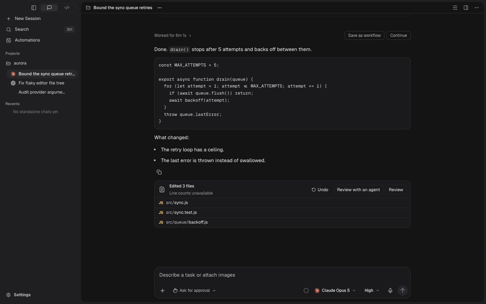

# Chat design — applied to production components

2026-11-10. The reviewed design is implemented in
`packages/ui/src/chat.css`. This directory is the development review surface,
not a separate implementation of Gyro.

## Open the design

Run `pnpm --filter @gyro-dev/desktop dev`, then open the
[real-component preview](http://127.0.0.1:1420/chat-design-preview.html?scene=active-chat&edge=code-block&theme=dark&environment=closed&reset=1).

The page boots the actual `main.tsx` and `App.tsx`, the production stylesheet,
and the existing fake Tauri IPC fixture. App components, icons, menus,
composers, panes, drafts, disclosure controls and review panels are real.
Repository and provider responses are fixture data. No real repository action
or provider turn is performed by opening the preview.

Expand **Design preview · Applied** to select a scene, theme and interface
size. **⌥D** hides/shows those developer controls; `review=0` omits them.
The controls are outside React's `#root`. There is no Current/Proposed skin or
reading-size override now: the preview displays the production design directly.
Resize the browser for narrow layouts.



## Production contract

| Block decision | Applied value |
| --- | --- |
| Shared column | 760px maximum; 24px × interface scale at pane edges |
| Reading | 15px × scale, 1.6 line height, including live narration |
| Work / metadata | 13px / 12px × scale |
| Surfaces | Canvas and raised; actual product palette, with the light raised mapping |
| Radius | 12px user/code/change/file surfaces; existing 18px composer token |
| Spacing | 24px between turns; 12px between blocks; 4/8/16px smaller steps |
| Actions | Neutral ink, including its hover variant; chosen accent for focus |
| Environment | Existing component and handlers in a reserved right grid track |
| Tight panes | Existing toolbar actions wrap when there is insufficient width |
| Motion | 120/240ms; reduced-motion and ongoing progress retain separate semantics |

Tokens and state rules have one owner. Core blocks have one sizing/type/surface
rule rather than competing historical values. The former component CSS files
were folded into that owner and their imports removed. Shared app-shell,
provider-logo, file-identity and navigation primitives retain their own owners.

## Verification

Wytze’s later list-alignment correction is documented in
[the design-pass review](../../docs/design/chat-design-pass-2026-11-10.md).
It supersedes the initial visual acceptance for lists and adds wrapped/numbered
fixtures plus child-text geometry checks.

- The mechanical move preserved 100 computed snapshots and 36 independently
  bundled production snapshots before intentional design changes.
- Full-page comparison after the move matched 91/100 images exactly. The nine
  others differed in only 3–26 header antialiasing pixels, by at most 3/255 per
  channel. This is recorded as a rasterisation limitation, not pixel identity.
- The current 112-state matrix checks themes, interface sizes, single/split/
  stacked/three-pane layouts, code, lists, streaming, and forced hover/focus.
- Real preview controls were reviewed for the model picker, unsent draft,
  approval request, agent question and Environment actions.
- An isolated native WebKit build was visually checked for column alignment,
  code/lists, disconnected-provider composer and Environment. A real native
  sidebar drag created two panes and retained their independent drafts. This
  preceded the final margin-only cleanup. It is not live-provider or installed
  release acceptance. Its seeded transcript chronology is not an acceptance
  fixture for turn ordering.

Full evidence and scope notes are in
[`docs/design/chat-consolidation-review-2026-11-10.md`](../../docs/design/chat-consolidation-review-2026-11-10.md).
Local test artifacts are under `artifacts/chat-consolidation/`.

## Commands

```sh
pnpm smoke:workbench                  # source guards + all 112 rendered contracts
pnpm smoke:workbench:source           # source checks only
pnpm test:chat-render                 # local computed baseline comparison
pnpm test:chat-render --extended      # all 112 states
pnpm test:chat-render --extended --shots --audit-invariants
pnpm test:chat-render --extended --pixels --pixel-root=artifacts/chat-consolidation/pixels-applied
pnpm test:chat-drag-browser
```

The renderer runner starts Vite if needed and stops only the server it owns.
`GYRO_SNAPSHOT_FILTER=split` selects a subset. `GYRO_TEST_ORIGIN` and
`GYRO_BROWSER_DEBUG_PORT` allow isolated runs. `--no-start` requires an existing
server (use it against a separately bundled production capture).

Only update a local baseline for an intentional reviewed design change. CI
uses the machine-independent contracts rather than machine-specific font or
pixel goldens. The pixel tool is strict and may expose the tiny antialiasing
variation described above.

## Earlier artifacts

`proposal.css`, `fidelity-review.json`, `browser-review.json`, and
`screenshots/real-components/` retain the earlier real-component design review.
`proposal.css` is no longer imported. `static-v1/` retains the superseded
hand-built mockup; it is not the current product design.

No commit or replacement of the installed app is part of this delivery.
Sidebar and settings are the plan's separate follow-on screens.
